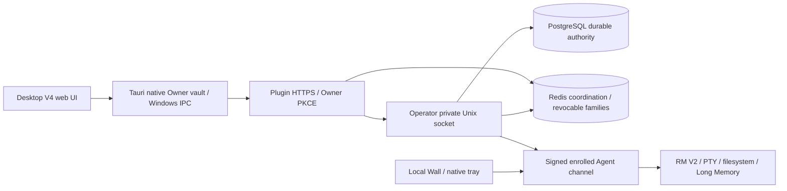

# Light Remote MCP architecture

The official project is `n8n2erpnext/light-remote-mcp`. This workspace has a new Git object store and no old parents or alternates. The new GitHub repository (ID1450214328) is the development/build source; old ARM source remains preserved reference truth.

Owner login grants `desktop:read`, never Agent execution rights. Device ownership, A/B consent, policy and device signatures remain separate checks. Operator/Plugin each hold an instance-scoped single-writer lock. PostgreSQL owns durable business state; Redis owns short-lived coordination and renewable retained sessions.

`config/endpoints.json` is the package-embedded endpoint catalog. `contracts/api.v1.json` describes reviewed Desktop integration boundaries; `lib/api-contract.mjs` supplies actual public/private route registrations and the API version header. Private Unix routes never become browser URLs. Other legacy route families remain in their existing modules; the catalog does not yet constitute an exhaustive OpenAPI schema.

Core migrations are checksum-locked through 043. Owner authority 045 is an explicitly pinned extension after core 043, with its own extension ledger. Guest 044 remains deferred because the native Guest runtime is unfinished. It is never marked ready by a ledger-only workaround.

Windows candidate0.10.1-dev.2 has one primary `LightRemote.exe`: Tauri/Rust owns GUI/tray and early headless role dispatch, and a fixed-path hostfxr adapter hosts the existing managed Windows implementation as a class library in-process. Private .NET8 frameworks remain DLLs under windows-host. Node, RM V2 and independent update/recovery helpers remain separate. Both old primary EXEs are absent from the final package; existing identities and authority boundaries are retained.

Project Continuity, Chrome Long Memory extension and RC50 portability source were recovered separately. Their availability in the tree is distinct from wiring into the active profile; see the feature matrix.

The [T12 handoff](docs/plans/windows-single-primary-exe/LIGHT_REMOTE_CORE_EXE_CONSOLIDATION_PLAN_20261107.md) records design alternatives. The implemented in-process option is described below and verified by the current [primary manifest](docs/evidence/windows-one-primary/PRIMARY_EXE_MANIFEST.json); it does not embed Node or merge independent recovery processes.

## Historical Windows host consolidation prototype

The work branch is testing the T12 in-process .NET-hosting option: one Tauri/Rust native executable calls a managed class library through bounded hostfxr exports. The audited Windows WMI, Job Object, supervisor, native Agent environment and Desktop action implementation remain in that library; no second managed apphost is extracted or executed. Private framework DLLs/runtime remain supporting files under windows-host. Native Owner vault/A-B/SSO authority is unchanged. The regular installer has not switched layout in this prototype step; native proof and compatibility gates precede that change.

## Package one primary LightRemote.exe and prove native migration lifecycle

Windows candidate0.10.1-dev.2 consolidates the previous GUI/hidden host primary binaries into `LightRemote.exe`. Tauri/Rust remains the window/tray and native Owner/keyring authority; a fixed-path hostfxr adapter calls a framework-dependent managed library in-process. The audited managed WMI, Job Object envelope, Agent supervisor/recovery and sanitized twelve-action bridge are reused. No managed apphost is published or extracted. Private .NET framework DLLs remain supporting runtime files. Node/RM/recovery-helper isolation is preserved.

Early OS-only CLI dispatch runs before GUI singleton or Owner/WebView initialization. Multiple independent roles may run from the same native file; closing GUI does not stop the Agent task. The GUI bridge is an allowlist, with no renderer-selected assembly, method, executable path or credential. Agent-only stop matches installed executable/argv/SID/creation time. Full updates use their separate runtime quiesce/health/ack/helper-promotion and verified rollback transaction. Layout JSON may choose only fixed compiled product/profile/file names; it is not an arbitrary executable registry. Native and actual migration CI, existing known issues and physical acceptance retain separate statuses.

## Implement verified native device API and fix Memory startup and Desktop ACL gaps

Added native transport desktopDevice in contracts/api.v1.json: desktop_owner_device_request -> fixed same-user Agent pipe/Unix socket -> desktop-device-api.mjs. Native Owner bearer stays in Rust/Agent; Agent independently verifies current issuer/account and exact enrolled device before dispatch and before projection. Only device.read may discover the current device without a prior deviceId; all mutations require the displayed deviceId. Explicit action allowlist reuses modules.configure CAS, real Memory scope lifecycle/account sync/device-signed tombstones, Codex task CAS/delegation, signed session-close/job-cancel, and private activity-log controls. Default OFF unless the existing exact Gold A/B native package flag/gates are satisfied; no HTTP bypass, wildcard IPC, arbitrary path/shell or Owner-login-to-Agent-grant conversion. Device read uses cheap local state; optional remote Memory roster/policy has one shared in-flight request and bounded wait. Long Codex observation is acknowledged as requested and polled for actual completion, never inferred success.

## Connect Desktop controls to the verified Agent API and unify displayed names

Desktop native-device.ts/useNativeDevice is a scoped read/write provider: current Owner + native expectedAccountId + enrolled device, single-flight visible polling, account/generation invalidation, pre/post-write real reads and no automatic mutation retries. Rust owner_device uses fixed private IPC and native-only bearer. Existing Agent module/controllers execute operations. Settings host start/restart/update remains an exact compiled native action for Agent-offline recovery; it carries no browser credential. Device-change events refresh Owner read models only for the matching account.

## Defer Windows close hide beyond callback and preserve installed responsiveness checks

Windows hide-to-tray must not synchronously change visibility inside CloseRequested. The callback immediately prevents destruction and queues hide from the existing Tauri worker runtime, allowing native listeners to finish before focus/visibility messages. Background Agent/session ownership is unchanged. Source diagnosis follows pinned tauri-runtime-wry2.12.3: https://raw.githubusercontent.com/tauri-apps/tauri/tauri-runtime-wry-v2.12.3/crates/tauri-runtime-wry/src/lib.rs (on_close_requested listener mutex, same-thread send_user_message and WindowMessage::Hide). This is a source-based reentrancy diagnosis; installed CI must confirm the behavior.

## Restore singleton window through owning Tauri runtime to synchronize visibility

Singleton restore uses fixed Local\LightRemoteDesktopV4UnifiedOwner.Show auto-reset Windows event under the existing OS-user/session object boundary. Primary publishes before initialization, then one waiting thread handles show. Secondary signals foreground launch only; the existing GUI restores via owning Tauri worker show/unminimize/focus. There is no command/path/identity/credential payload or new browser/native-action API. Raw ShowWindow remains only for older binaries without the event. CI59 showed responsive second-Close failure after raw restore. Pinned Tao0.37.2 set_visible stores VISIBLE and apply_diff skips unchanged flags: https://raw.githubusercontent.com/tauri-apps/tao/tao-v0.37.2/src/platform_impl/windows/window.rs and https://raw.githubusercontent.com/tauri-apps/tao/tao-v0.37.2/src/platform_impl/windows/window_state.rs . Earlier reentrancy-only diagnosis was insufficient. Installed CI must confirm this restore/cache repair.

## Reconcile actual hidden window state before singleton restore

Owning-runtime singleton show additionally reconciles actual visibility: Tao0.37.2 is_visible reads the native OS state, while set_visible/apply_diff use cached flags. If actually hidden, enqueue Tauri hide to normalize VISIBLE=false, then owning-runtime show/unminimize/focus. If already visible, skip normalization to avoid flicker. This handles both out-of-band raw Win32 hide and former raw show without removing the installed raw-hide fixture. Source: https://raw.githubusercontent.com/tauri-apps/tao/tao-v0.37.2/src/platform_impl/windows/window.rs and https://raw.githubusercontent.com/tauri-apps/tao/tao-v0.37.2/src/platform_impl/windows/window_state.rs . No arbitrary HWND/path/request payload, credentials or new renderer API is introduced.

## Bind recovery Wall health proof to validated installed package revision

Recovery helpers may survive a Core rollback to a different endpoint configuration revision. Updater/InstallWatchdog use IsInstalledWall, which selects revision from a <=16KiB, non-reparse installed package marker only after exact compiled product/profile validation. It retains exact installed Node path, listener PID and a fresh nonce/constant-time HMAC over that selected revision. The HTTP response never selects the expected revision; there is no retry-any-revision or trust of TCP LISTEN alone. Regular GUI/client IsExpectedWall still binds its compiled revision. Fixed loopback URL/port/Host and user key boundary remain unchanged. Native tests cover current/legacy revision selection, wrong profile/oversized marker and existing2/3 vectors plus tamper checks.

## Checkpoint fresh Windows distribution redesign and verified dev5 Lab deployment

The unified Tauri tray currently uses a static default icon while managed TrayIconFactory and VisualFor retain five-state assets/semantics. New wiring will reuse that trusted sanitized snapshot projection and Moryqa exports. Dev5 Operator/Plugin deployment now serves canonical consent presentation; authorization/issuer/API identities and independent local runtime boundaries are unchanged.

## Preserve native RMv2 cursors and honor precise input timing

Windows RMv2 uses ControlActivity metadata hooks and tagged native input for Owner takeover; WPF badge/four edge windows are activity-only. System cursor component is recovery-only; no automatic guardian/reload. Native request lane remains serial in phase1; independent pipe watch cancels disconnected input. No GPU/video backend added.

## Keep RMv2 input hooks independent of overlay rendering

ControlActivity owns one dedicated metadata hook thread with a Win32 message loop; callbacks update atomic generation/timestamps and immediately continue the hook chain. WPF badge/edge rendering remains on the GUI thread. Initialization wait is bounded3s; missing monitor denies input. Stop/dispose posts WM_QUIT, unhooks in its owning thread and waits at most1s. https://learn.microsoft.com/en-us/windows/win32/winmsg/lowlevelmouseproc

## Keep RMv2 working sessions visible and yield input without failing Agent sessions

Indicator is awareness, not authorization. First input arms it against existing visual/semantic working-session lifetime; standalone30s grace, disconnect/detach/desktop loss stop; read-only attach alone does not arm. Paused feedback lasts8s. Four nonactivating/click-through full WPF edge surfaces per monitor and visible-pixel cursor-tail badge are separate windows. OwnerInputPause is caught at native RPC operation boundary as a paused data receipt; session/background jobs stay alive and unsafe input is not replayed. User and Agent cannot have independent physical foreground focus just by tiling windows.

## Require explicit RM task scopes with confirmed close,45s orphan cleanup and sky-blue awareness

RM task lifecycle is independent from durable A/B authority. lib/rmv2-task-lifecycle.mjs owns exact session+Agent selection, pending-operation drain, close failure/retry fences and non-resurrection. Device Agent attaches actual native lease to input/run/semantic mutation after owner validation; public tool clients never supply native lease secrets. Existing native private same-user CLI compatibility is not the public Agent API. Native current control visual ID drives awareness; explicit detach awaits GUI hide, expired scoped awareness has no extra30s standalone tail. Child semantic/live resources created inside task scope close with it.

## Add ordered RM work with fast scoped cancel and explicit pointer profiles

Windows native RPC now dispatches through RpcWorkScheduler: dedicated MTA ordered input+semantic state lane capacity16, separate frame lane capacity2, bounded fast metadata/cancel concurrency4. Responses correlate existing IDs and can finish out of order; input remains ordered. Semantic state itself stays serialized with input pending later observation cache review. Exact native visual lease authorizes cancel before epoch fence; cancelled queued work cannot silently run and later explicit work captures a fresh epoch.

## Add target-bound Unicode writes with verified progress and live authority checks

RmTextWrites is a device-local one-active-write bounded controller; metadata receipts expire15min, no restart replay. One RM withScope spans the complete logical write, not a minutes-long Hub RPC. Native LogicalTextWriter/TypingTarget bind process creation, foreground/focus HWND, UIA runtime identity when available, owner/focus generations. Short native chunks stay on the ordered MTA lane; status/cancel stay independent. Prefix/suffix readback validates insert/append; prefer returns unverified if unsupported, required rejects preinput. Password content is never read. No readback after interrupted/revoked cleanup. A signed enrolled-channel desktop-work-authorize snapshot is capped1s with per-chunk local policy/identity/root checks; snapshots never extend A/B absolute expiry. No hard Agent/session termination or forced refocus.

## Reuse fresh RM capture buffers and add crop-aware frame coordinates

DesktopVisual delegates to GdiFrameCache with one mutex-protected private entry: reusable24bpp source/output bitmaps and Graphics, dense reusable pixel buffer, cached JPEG codec/stream/base64. Each call copies current cropped pixels and hashes every row excluding padding before reusing encoding. Topology/settings/crop key invalidates buffers; final visual detach and helper exit clear private pixels/cache. No background capture timer. Native previous-encoded-SHA hint can omit unchanged data before IPC; never substitutes cached pixels for a fresh screen read. Agent holds only latest owner-scoped frameSeq/bounds/size/monotonic request time for optional frame coordinate conversion, preserving the native topology pin. Generic ui.changed signals are latest-state hints coalesced through one bounded pending slot40ms; semantic journal deltas preserve their existing path.

## Bind typing target before cooperative large-text preparation

RmTextWrites reserves the single preparing slot before expensive work. Complete cheap type/size/Unicode/options validation precedes native preflight; native target is captured before asynchronous whole-grapheme validation. Preparation yields at8192 units or8ms and checkpoints authority/local policy/cancel/task/deadline, with exact-scope native resume only for running preparation. Progress exposes validated prefix separately from acceptedUnits0 until the complete payload is valid; no keyboard packet can be sent earlier. A local-input/focus change while preparing invalidates the original native target, rather than adopting the new control. Pacing duration lower-bound is checked before any input, avoiding millions of pointless small chunks for a deadline that cannot fit. Run uncertainty retains last ACK and never resets a possibly sent prefix to0.

## Separate root-guarded UIA observation from ordered input

UIA read-only snapshot/event requests now use one dedicated persistent windowless MTA, independent from ordered physical/semantic mutations and the existing capture/control lanes. Queue capacity2 applies backpressure; no per-request unbounded threads or shared AutomationElements. Semantic snapshot pins primitive root HWND/title/epoch and input/state/focus generations, traverses outside the manager gate, revalidates membership/root before publication and reports concurrent changes as resyncRecommended. Desktop root drift rejects semantic_snapshot_changed_reobserve. Events/root metadata are read consistently under the same manager gate. OnUiChanged no longer works on detached copied sessions or recreates pending entries after detach. Existing provider calls can still hang the observation worker; no unsafe abort; existing helper hard reset/reobserve remains recovery. Attach/detach/acts and typing verification remain ordered.

## Add optional exact-monitor DXGI capture with fresh GDI recovery

Optional DXGI is a capture provider only. Existing Agent/A-B/Owner/local-policy/requested-screen/ROI/45s visual scope boundaries stay authoritative; it opens no new socket, transport, renderer, desktop or input authority. Default GDI does not create any GPU device. Owner can opt in via LIGHT_REMOTE_RM_CAPTURE_BACKEND=dxgi before starting the app/helper. Exact Screen.DeviceName and virtual bounds choose the correct enumerated adapter/output; rotated or changed outputs fail to a NEW GDI copy. Acquire timeout16ms, one reusable staging texture<=16M pixels, requested ROI/pitch/BGR conversion validated, D3D frame release/unmap/disposal on every path and monotonic2s recovery backoff. GPU-to-CPU staging and CPU JPEG/resize are explicit; no zero-copy/hardware codec claim. Last visual close/helper shutdown clears GPU/cache resources. Nonblocking status returns busy metadata rather than waiting on a driver. A driver Map can still block capture; existing helper watchdog/reobserve is recovery. Control/input remain on their independent lanes.

## Wait for native text delivery and fence expired input authority

Evidence-driven logical-text delivery: accepted SendInput events can remain queued after the call returns. Bound internal logical chunks and maximum indivisible grapheme to128UTF16 units; total transport/reference budgets remain262144/8M units. After each complete chunk, when target readback exists and verification is not none, wait for the entire expected prefix+sent+suffix before allowing another chunk. Empty writable ValuePattern is preferred for readback only, avoiding empty TextPattern end-range artifacts; insertion remains Unicode keyboard packets. Unsupported verification remains explicitly unverified. Already queued OS events cannot be retracted/isolated against all foreground changes; no BlockInput, system cursor override, SetValue substitution, clipboard or automatic replay. Changed focus/Owner generation/cancel/deadline stops remaining work. Native receipt historical lastObservedInsertedUnits is distinct from final verifiedInsertedUnits. Signed-authority freshness budget is refreshed near expiry, forwarded to the private bridge, reduced by helper startup, then rebound to an unforgeable native monotonic deadline at pipe admission; queued stale requests reject before handling, and guarded packets/readback stop at expiry. Time is not subtracted between server/client wall clocks. UIA snapshots now also observe direct native operation start/end and physical Owner generations, not only semantic journal input sequence.

## Keep RM capture cleanup responsive and correct native measurements

Visual expiry/status/detach request capture cleanup atomically and try the capture gate without waiting. An in-flight capture drains pending cache/DXGI disposal in its finally block; the next capture also drains before allocation. cleanupPending exposes deferred cleanup and the post-capture visual session fence still rejects a closed scope. A hung driver may defer actual disposal until capture returns or helper watchdog reset; status/close must stay responsive. Idle scope close clears immediately. Native selftest holds capture gate and checks cleanup returns promptly, then drains; capture acceptance checks no active DXGI/cache cleanup after scope close.
