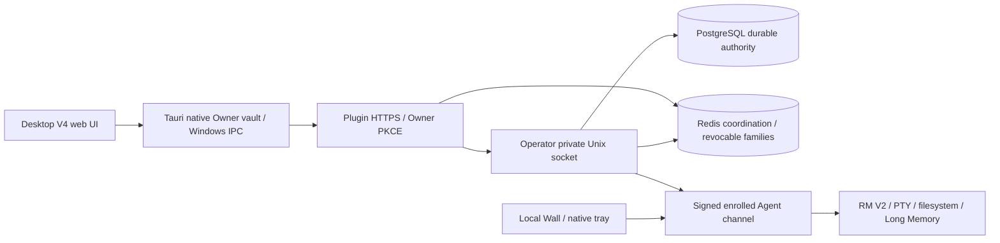

# Light Remote MCP architecture

The official project is `n8n2erpnext/light-remote-mcp`. This workspace has a new Git object store and no old parents or alternates. GitHub cutover has not occurred.

Owner login grants `desktop:read`, never Agent execution rights. Device ownership, A/B consent, policy and device signatures remain separate checks. Operator/Plugin each hold an instance-scoped single-writer lock. PostgreSQL owns durable business state; Redis owns short-lived coordination and renewable retained sessions.

`config/endpoints.json` is the package-embedded endpoint catalog. `contracts/api.v1.json` describes reviewed Desktop integration boundaries; `lib/api-contract.mjs` supplies actual public/private route registrations and the API version header. Private Unix routes never become browser URLs. Other legacy route families remain in their existing modules; the catalog does not yet constitute an exhaustive OpenAPI schema.

Core migrations are checksum-locked through 043. Owner authority 045 is an explicitly pinned extension after core 043, with its own extension ledger. Guest 044 remains deferred because the native Guest runtime is unfinished. It is never marked ready by a ledger-only workaround.

Windows currently has the existing C# native Agent/tray host plus Tauri V4 UI. Combining these into one `LightRemote.exe` is a later product change. Node, RM V2, updater/helper and current feature behavior remain intact in this baseline.

Project Continuity, Chrome Long Memory extension and RC50 portability source were recovered separately. Their availability in the tree is distinct from wiring into the active profile; see the feature matrix.
