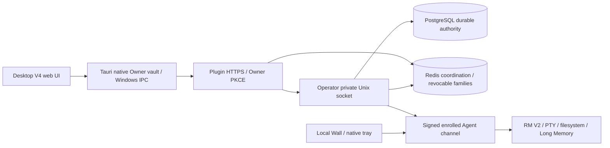

# Light Remote MCP architecture

The official project is `n8n2erpnext/light-remote-mcp`. This workspace has a new Git object store and no old parents or alternates. The new GitHub repository (ID1450214328) is the development/build source; old ARM source remains preserved reference truth.

Owner login grants `desktop:read`, never Agent execution rights. Device ownership, A/B consent, policy and device signatures remain separate checks. Operator/Plugin each hold an instance-scoped single-writer lock. PostgreSQL owns durable business state; Redis owns short-lived coordination and renewable retained sessions.

`config/endpoints.json` is the package-embedded endpoint catalog. `contracts/api.v1.json` describes reviewed Desktop integration boundaries; `lib/api-contract.mjs` supplies actual public/private route registrations and the API version header. Private Unix routes never become browser URLs. Other legacy route families remain in their existing modules; the catalog does not yet constitute an exhaustive OpenAPI schema.

Core migrations are checksum-locked through 043. Owner authority 045 is an explicitly pinned extension after core 043, with its own extension ledger. Guest 044 remains deferred because the native Guest runtime is unfinished. It is never marked ready by a ledger-only workaround.

Windows candidate0.10.1-dev.2 has one primary `LightRemote.exe`: Tauri/Rust owns GUI/tray and early headless role dispatch, and a fixed-path hostfxr adapter hosts the existing managed Windows implementation as a class library in-process. Private .NET8 frameworks remain DLLs under windows-host. Node, RM V2 and independent update/recovery helpers remain separate. Both old primary EXEs are absent from the final package; existing identities and authority boundaries are retained.

Project Continuity, Chrome Long Memory extension and RC50 portability source were recovered separately. Their availability in the tree is distinct from wiring into the active profile; see the feature matrix.

The [T12 handoff](docs/plans/windows-single-primary-exe/LIGHT_REMOTE_CORE_EXE_CONSOLIDATION_PLAN_20261107.md) records design alternatives. The implemented in-process option is described below and verified by the current [primary manifest](docs/evidence/windows-one-primary/PRIMARY_EXE_MANIFEST.json); it does not embed Node or merge independent recovery processes.

## Historical Windows host consolidation prototype

The work branch is testing the T12 in-process .NET-hosting option: one Tauri/Rust native executable calls a managed class library through bounded hostfxr exports. The audited Windows WMI, Job Object, supervisor, native Agent environment and Desktop action implementation remain in that library; no second managed apphost is extracted or executed. Private framework DLLs/runtime remain supporting files under windows-host. Native Owner vault/A-B/SSO authority is unchanged. The regular installer has not switched layout in this prototype step; native proof and compatibility gates precede that change.

## Package one primary LightRemote.exe and prove native migration lifecycle

Windows candidate0.10.1-dev.2 consolidates the previous GUI/hidden host primary binaries into `LightRemote.exe`. Tauri/Rust remains the window/tray and native Owner/keyring authority; a fixed-path hostfxr adapter calls a framework-dependent managed library in-process. The audited managed WMI, Job Object envelope, Agent supervisor/recovery and sanitized twelve-action bridge are reused. No managed apphost is published or extracted. Private .NET framework DLLs remain supporting runtime files. Node/RM/recovery-helper isolation is preserved.

Early OS-only CLI dispatch runs before GUI singleton or Owner/WebView initialization. Multiple independent roles may run from the same native file; closing GUI does not stop the Agent task. The GUI bridge is an allowlist, with no renderer-selected assembly, method, executable path or credential. Agent-only stop matches installed executable/argv/SID/creation time. Full updates use their separate runtime quiesce/health/ack/helper-promotion and verified rollback transaction. Layout JSON may choose only fixed compiled product/profile/file names; it is not an arbitrary executable registry. Native and actual migration CI, existing known issues and physical acceptance retain separate statuses.
