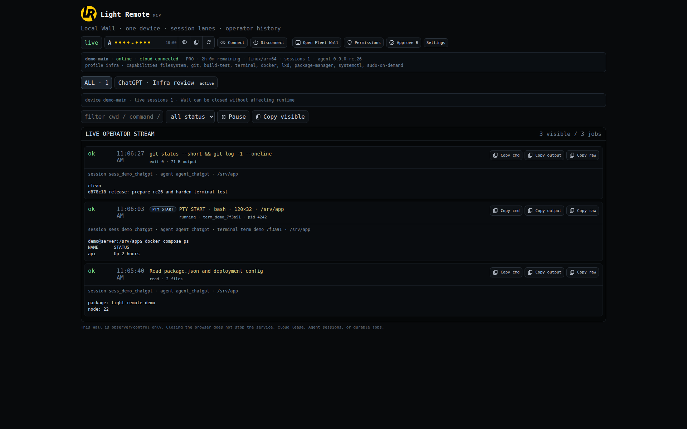
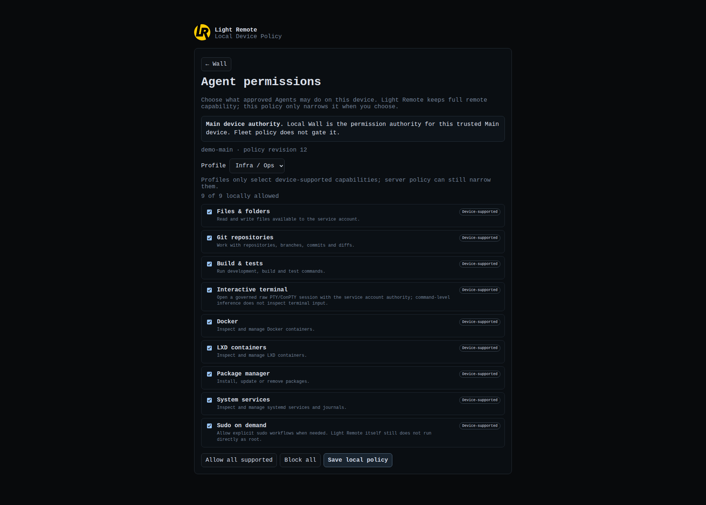

# Light Remote MCP

<p align="center">
  
</p>
<p align="center">
  <strong>Let ChatGPT, Codex and AI agents work on your own devices over MCP — with final control retained locally.</strong>
</p>
<p align="center">
  <a href="README.md">Tiếng Việt</a> · <a href="README.en.md"><b>English</b></a>
</p>
<p align="center">
  
  
  
  
  
  
</p>

**Light Remote** provides governed remote computing for AI agents: **direct HTTPS MCP, local A/B V2 approval, device-local policy, durable sessions, real PTY/ConPTY terminals, filesystem/search/process/SCP tools, Fleet and Real Remote V2 desktop interaction**.

**The current path is direct Plugin → private Operator → authenticated outbound Device Agent. Vercel bridge is no longer needed.** Historical Vercel-related source files or dependencies may remain in the repository, but they are not a required hop in the current MCP connection.

> **Release scope:** `0.10.1-dev.4` is an **internal development/testing candidate**, not a public binary GitHub Release or promoted signed update feed. Passing CI does not establish physical Owner acceptance. See [Current status](#current-status) before upgrading any installed system.

## Why Light Remote instead of a conventional remote shell?

- **Local-first authority:** Owner OAuth login does not grant AI device execution rights. Device-specific A/B approval and effective local policy are separate checks.
- **Outbound-first Agent:** Windows/Linux/macOS devices connect outward; leaf devices do not need inbound SSH exposed to AI.
- **Exact target routing:** Jobs are bound to the chosen device/session/Agent; an offline or denied target never silently falls back to a different device.
- **Durable work:** Recover process, session and job output across requests without rerunning a previous operation.
- **Real terminals and desktop:** PTY/ConPTY, semantic/live Real Remote V2 observation and bounded UI input are distinct permissions, not shell emulation.
- **Visibility and revocation:** Local Wall shows activity, sessions and approvals and keeps final policy denial at the device.
- **Controlled updates:** Independent updater/helper, signed manifests, SHA-256 checks, health gates and rollback. The new candidate's public feed is **on hold**.

## Architecture at a glance — direct, without Vercel

```text
ChatGPT / Codex / compatible MCP client
              |
              | OAuth / HTTPS Streamable HTTP
              v
    Public Light Remote Plugin
          POST /mcp
              |
              | private Unix socket
              v
      Light Remote Operator
      identity / A-B grants / sessions
          |              |
     PostgreSQL 17     Redis 8
       durable       coordination
              |
              | signed enrolled outbound channel
              v
      Exact authorized Device Agent
      Windows / Linux / macOS
              |
      Local Wall (final deny)
      files · search · exec · PTY · process · SCP
      Real Remote V2 · optional modules
```

- The current [`mcp.json`](mcp.json) declares **`https://light-remote.thaiduy.digital/mcp`** as the public Streamable HTTP MCP endpoint.
- [`plugin-server/server.mjs`](plugin-server/server.mjs) handles OAuth, tool exposure and `POST /mcp`. It rejects `GET/DELETE /mcp` rather than offering a stateful HTTP session API.
- [`plugin-server/operator-client.mjs`](plugin-server/operator-client.mjs) calls the Operator over a **private Unix socket**, without a Vercel proxy hop.
- [`operator-host/`](operator-host/), [`device-agent/`](device-agent/), [`client/`](client/) and PostgreSQL/Redis implement authority, durable state and remote execution.
- [`config/endpoints.json`](config/endpoints.json) is a package endpoint/profile declaration, **not evidence that every listed profile or route is deployed or enabled**.
- Owner Desktop V4 retains native credential storage/PKCE and a separate read-only Owner scope. Owner `desktop:read` is not an Agent execution grant.

See [Architecture](ARCHITECTURE.md) and [Code Map](docs/project-book/LIGHT_REMOTE_CODE_MAP.md) for source ownership and trust boundaries.

## What an Agent can do

| Tool family | Capability |
| --- | --- |
| Files | Bounded list/read/write/edit/stat/move/delete |
| Search | Search paths or contents with paginated results |
| Git and development | Inspect repositories, run build/tests if policy allows |
| Exec | One-shot shell/PowerShell/zsh commands with timeouts |
| Processes | Managed stdin/stdout, progress offsets and stop |
| Terminal | Real Linux/macOS PTY or Windows ConPTY, signals and resize |
| Transfer | Chunked, resumable, SHA-256-verified SCP |
| Jobs | Durable work and output recovery |
| Fleet | Exact-device selection/routing and per-device policy |
| Real Remote V2 | Semantic/live desktop observation and bounded input |
| Optional modules | Long Memory, Codex Bridge and activity history, subject to actual enablement |

**Implemented source does not mean enabled production functionality or physical acceptance.** Read [Feature Status](FEATURE_STATUS_MATRIX.md) and [Known Issues](KNOWN_ISSUES.md).

### Real PTY/ConPTY, not a fake terminal

Terminals can keep interactive shells and TUI applications alive, receive typed input, resize, handle Ctrl-C and stream output. Terminal privileges must be granted separately by the device policy.

## Device Wall — device-side permissions and history

<p align="center">
  
</p>

Local Wall belongs to a particular device. It exposes A/B pending approval, sessions, work activity and effective policy. Closing the Wall UI does not automatically stop the Agent or revoke all sessions.

<p align="center">
  
</p>

Execution requires the intersection of hardware/runtime capabilities, approved account/device grants and **device-local policy**. A broad profile does not automatically imply sudo/UAC. Device-local denial remains final.

## Fleet Wall — many devices, one exact target per operation

The Main/Fleet model supports account-owned devices, their online/offline status, per-device authority and sessions, subject to entitlements and deployed features. Pairing with one machine does **not** authorize another machine. Offline/expired/denied targets fail rather than silently rerouting a command.

## The three Helpers

### 1. Connection Helper — A/B V2

1. Open the **Local Wall of the intended target device** and obtain its one-time **A code**.
2. Give that A code to the official Light Remote plugin's `light_remote_connection_helper`.
3. The helper responds `approval_required` with a **B code**.
4. On the **same Local Wall**, enter B at `/approve` and select **Approve**.
5. After the Owner approves, call the helper again **without reusing A**. Only the `ready` response authorizes working with that exact returned device/session context.

Owner OAuth by itself cannot skip A/B device authorization. Never post private continuation tokens, device keys or session capabilities in issues or chat examples.

### 2. Tool Helper — choose the correct tool

After `ready`, use dedicated files/search tools for structured operations, exec for one-shot commands, process/job for longer work, terminal for real PTY/ConPTY, transfer for binary files and desktop tools for Real Remote V2. Do not force every task through a raw shell.

### 3. Updater Helper — independent recovery

Independent helpers validate signed update manifests and artifact hashes, stage a candidate, check health and roll back on failure. Historical `0.9.x` manifests are **not** a signed public feed for `0.10.1-dev.4`.

## Quick start — the direct MCP path

**Current availability:** this README documents the internal development candidate. It is **not** a claim of a ready-made public one-command production self-host installer.

### Step 1 — use the official source and verified candidate

- Official source: [n8n2erpnext/light-remote-mcp](https://github.com/n8n2erpnext/light-remote-mcp).
- Historical reference only: [light-remote-mcp-archive-20261108](https://github.com/n8n2erpnext/light-remote-mcp-archive-20261108). Its Vercel/RC26 instructions are obsolete.
- Windows internal candidate: `0.10.1-dev.4`, compiled source `947a117`, [CI #45 9/9 PASS](https://github.com/n8n2erpnext/light-remote-mcp/actions/runs/42628405851), [internal Actions artifact](https://github.com/n8n2erpnext/light-remote-mcp/actions/runs/42628405851/artifacts/13679554745). **Not a public release.**
- Windows now packages **one primary `LightRemote.exe`**, while Node, Real Remote V2, private .NET framework DLLs and updater/recovery helpers remain separate. Older incompatible helpers must take the [pinned compatibility bridge](config/windows-core-migration.json).
- Linux/macOS native source checks passed CI, but full current-source installers are not yet verified as built.

Read [Build and Deployment](BUILD_AND_DEPLOYMENT.md) and verify manifest/hash evidence before running a candidate.

### Step 2 — direct Plugin/Operator service

The intended path is **HTTPS reverse proxy → Plugin `/mcp` → private Operator Unix socket → PostgreSQL/Redis → enrolled outbound Agent**. **No Vercel account/project/deployment or legacy `VPS_MCP_*` environment variables are required.**

Developers should inspect [plugin config](plugin-server/config.mjs), [Architecture](ARCHITECTURE.md), [Code Map](docs/project-book/LIGHT_REMOTE_CODE_MAP.md) and [Build/Deployment](BUILD_AND_DEPLOYMENT.md). Expose only the intended public HTTPS routes. Never expose private Operator sockets, PostgreSQL, Redis, Local Wall or credential files to the Internet.

### Step 3 — install/link the target

Install an Owner-authorized build appropriate for the device, complete its native Owner/device linking and confirm the Agent is connected. Open the device's **Local Wall**. In the bundled lab profile, Wall is on `127.0.0.1:5491` and Fleet Wall on `5492`; these are local services, not public endpoints. The Windows client includes GUI/tray and a background Agent; other platform packaging depends on the verified build.

### Step 4 — approve an AI client

Connect the official Light Remote plugin to ChatGPT/Codex or another supported client. Generate A at the target Wall, pass it to the helper, enter B on that **same Wall**, then resume the helper until `ready`. You may then ask for source inspection, builds, Docker checks, a PTY session, SHA-verified file transfer or allowed Real Remote V2 UI operations.

### Step 5 — add another device

Enroll and approve A/B separately for each additional target. One session never silently grants a whole Fleet.

## Updates, rollback and releases

The update architecture supports signatures, SHA-256/size integrity, health-gated promotion and rollback. Scope matters:

- **CI PASS:** Source and exact Windows install/reinstall/migration/rollback/watchdog/uninstall tests passed; this is not blanket live deployment proof.
- **Internal Lab deployment:** Plugin/Operator services were verified running a pinned source, not a general production rollout.
- **Physical Owner acceptance:** still pending for the exact dev.4 Windows installer.
- **Public binary release and new signed feed:** **NOT PUBLISHED**; legacy signed `0.9.x` metadata remains historical.

Do not republish old release URLs or promote public update feeds without deliberate Owner approval and fresh verification.

## Security model

OAuth/Owner scopes are separate from device-level AI execution. A/B approval is one-time and device-bound; server/device checks bind operations to account, Agent, session and exact target. Device-local final policy, capability inference, signed enrolled channels, private Unix socket transport and separately controlled PTY/desktop permissions reduce unauthorized execution paths.

- Local browser Wall SSO backend exists and has scoped tests, but full native Agent/browser bootstrap is **not complete**.
- Guest/Pro Share, restored prototype modules and full current-source Linux/macOS installers retain documented gaps.
- Review [SECURITY.md](SECURITY.md), [Feature Status](FEATURE_STATUS_MATRIX.md) and [Known Issues](KNOWN_ISSUES.md). Keep signing material, Owner tokens and local state out of Git/logs.

## Developers and repository governance

The official Git SSH remote on VPS-ARM is `git@github.com:n8n2erpnext/light-remote-mcp.git`.

- The single Owner-authorized development branch is **`work`**; `main` is protected and requires `baseline-required` before fast-forward promotion. No new branches, force pushes or relaxed protections without Owner permission.
- Newly created Light Remote development paths on VPS-ARM must stay under `/home/ubuntu/n8n2erpnext/light-remote-unified-20261108/`. The current development checkout is `implementation-20261108/single-primary-exe`; conversion and archive are reference sources.
- Every commit atomically updates the sole [Master Checkpoint](MASTER_CHECKPOINT.json), [Handoff](PROJECT_HANDOFF.md), [Worklog](docs/project-book/LIGHT_REMOTE_WORKLOG.md) and generated docs status. The commit-sync hook and CI enforce this.
- Read [Project Truth](PROJECT_TRUTH.md), [Project Book](docs/project-book/README.md), [Code Map](docs/project-book/LIGHT_REMOTE_CODE_MAP.md) and [Build and Deployment](BUILD_AND_DEPLOYMENT.md).

Portable development validation (Node 22 and suitable DEV dependencies):

```bash
npm ci --ignore-scripts
npm run check:truth
npm run check:docs
npm test
```

Native Windows builds and acceptance require clean exact GitHub commit CI; running portable tests locally is not equivalent to a verified physical installer.

## Current status

| Component | Verified scope |
| --- | --- |
| Windows Desktop | Internal `0.10.1-dev.4`; one primary `LightRemote.exe`; native installed lifecycle CI PASS |
| CI | [#45](https://github.com/n8n2erpnext/light-remote-mcp/actions/runs/42628405851) **9/9 PASS**, React 121, consent/token 36, browser 170, private backend 25 and native Windows migration/rollback |
| Internal Plugin / Operator | Same pinned source `947a117` deployed and health-checked in internal Lab |
| PTY / Fleet / Real Remote | Source and scoped historical/CI evidence; physical cross-device proof for this candidate remains separate |
| Owner physical dev.4 | **PENDING** |
| Current Linux/macOS full installers | **NOT VERIFIED BUILT** (native source tests passed) |
| Public binary Release / signed dev.4 feed | **HOLD / NOT PUBLISHED** |
| Local browser Wall SSO, Guest and restored modules | **INCOMPLETE** |

For exact evidence see [dev.4 acceptance](docs/evidence/desktop-user-experience/ACCEPTANCE.json), [Build manifest](docs/evidence/desktop-user-experience/BUILD_MANIFEST.json) and [Known Issues](KNOWN_ISSUES.md).

## License

Apache-2.0 — see [LICENSE](LICENSE), [NOTICE](NOTICE) and [THIRD_PARTY_DISTRIBUTION_NOTICES.md](THIRD_PARTY_DISTRIBUTION_NOTICES.md).
