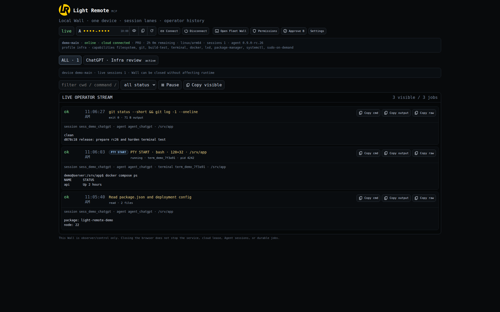

# Light Remote MCP

<p align="center">
  
</p>

<p align="center"><strong>AI có thể nhìn, hiểu và thao tác trên máy thật — nhưng quyền điều khiển vẫn thuộc chủ thiết bị.</strong></p>
<p align="center"><a href="README.md"><b>Tiếng Việt</b></a> · <a href="README.en.md">English</a></p>
<p align="center">
  
  
  
  
  
</p>

**Light Remote** là nền tảng remote computing có kiểm soát cho ChatGPT, Claude, Codex và các AI Agent tương thích MCP. Thay vì chỉ đưa cho AI một shell hoặc một ảnh chụp màn hình, Light Remote kết hợp **Real Remote V2 (RM V2)**, terminal PTY/ConPTY, filesystem, Git, process, file transfer, container/OS administration và Fleet dưới cùng một lớp phân quyền theo **tài khoản → thiết bị → Agent → session → Local Policy**.

- **Website:** [light-remote.thaiduy.digital](https://light-remote.thaiduy.digital/)
- **MCP endpoint chính thức:** [https://light-remote.thaiduy.digital/mcp](https://light-remote.thaiduy.digital/mcp)
- **ChatGPT plugin:** [Cài hoặc mở Light Remote trong ChatGPT](https://chatgpt.com/plugins/plugin_asdk_app_6aab6c4bd7d88191a4108d8f4c5e4b4e)
- **Source:** [n8n2erpnext/light-remote-mcp](https://github.com/n8n2erpnext/light-remote-mcp)

> **Trạng thái bản build:** Windows `0.10.1-dev.11` là ứng viên **kiểm thử nội bộ**, không phải bản phát hành nhị phân công khai. Tính năng có trong source, đã qua CI, đã deploy nội bộ và đã được Owner nghiệm thu trên máy vật lý là **những trạng thái khác nhau**. Xem [Trạng thái dự án](#trạng-thái-dự-án).

## Vì sao Light Remote khác công cụ remote thông thường?

- **AI làm việc được trên giao diện đồ họa thật:** RM V2 quan sát cửa sổ, đọc phần tử giao diện, theo dõi thay đổi và thực hiện thao tác chuột/bàn phím có giới hạn.
- **Không cần SSH inbound cho từng thiết bị:** Agent duy trì kênh kết nối outbound đã xác thực.
- **Chọn máy bằng Short ID:** Mỗi thiết bị có mã sáu ký tự ổn định, ràng buộc với device identity; AI không tự chọn nhầm máy Main hoặc nhảy sang máy khác.
- **A/B do Agent khởi tạo:** AI tìm thiết bị được phép xem, yêu cầu kết nối đến đúng Short ID và nhận mã **B** để chủ máy duyệt. **Luồng hiện hành không yêu cầu chủ máy tạo/gửi A code.**
- **Local Wall quyết định quyền cuối:** Phê duyệt kết nối không đồng nghĩa cho phép mọi lệnh. Local policy, quyền server và giới hạn tài nguyên vẫn được áp dụng.
- **Công việc bền và kiểm toán được:** Sessions, job IDs, output offsets, managed processes, terminal và activity trail cho phép tiếp tục công việc mà không tùy tiện chạy lại.
- **Nhiều hệ điều hành, nhiều thiết bị:** Windows, Linux, macOS với công cụ và giới hạn tính năng tùy hệ điều hành; Fleet không có fallback âm thầm.

## Kiến trúc hệ thống

```text
          ChatGPT · Claude · Codex · MCP Clients
                         |
                    OAuth / HTTPS
                         |
                 Light Remote Plugin
                 Streamable HTTP /mcp
                         |
                Private Unix socket
                         |
                 Light Remote Operator
              identity · grants · sessions
                  /               \
           PostgreSQL 17         Redis 8
           durable records      coordination
                         |
           Signed outbound device channel
                         |
                Exact enrolled device
            /             |             \
      Windows Agent    Linux Agent    macOS Agent
            \             |             /
                    Local Wall
              A/B · policy · activity
                         |
       RM V2 · Files · PTY · Processes · SCP · Fleet
```

MCP server nhận công cụ qua `POST /mcp` và kết nối với Operator bằng **Unix socket nội bộ**; Operator giữ quyền điều phối, session và định danh thiết bị. Agent trên máy đích chỉ thực hiện trong quyền đã được cấp và trong chính sách Local Wall. Owner login (ví dụ scope `desktop:read`) **không tự cấp Agent execution grant**.

Đối chiếu source: [MCP server](plugin-server/server.mjs), [Operator client](plugin-server/operator-client.mjs), [Operator](operator-host/), [Device Agent](device-agent/), [Architecture](ARCHITECTURE.md), [API Code Map](docs/project-book/LIGHT_REMOTE_CODE_MAP.md).

## Real Remote V2 (RM V2) — AI điều khiển máy tính thật

**RM V2 không phải chỉ gửi screenshot rồi đoán tọa độ.** Nó kết hợp quan sát hình ảnh, **semantic UI** và thao tác input hệ điều hành; Agent có thể ưu tiên phần tử giao diện có tên/ngữ nghĩa, chỉ dùng tọa độ khi cần.

### 1. Nhìn và quan sát trạng thái desktop

- Gắn vào desktop session, liệt kê các cửa sổ đang hiển thị, lấy frame giới hạn kích thước/chất lượng, đọc observation theo yêu cầu.
- Tạm rời hoặc kết nối lại observation session mà không đồng nghĩa khởi động lại Core Agent.
- Lấy một frame để đồng bộ ban đầu hoặc khi UI thay đổi quá lớn; không nhất thiết chụp toàn màn hình sau mỗi lệnh.

### 2. Hiểu giao diện qua Semantic UI

- **Windows UI Automation (UIA):** đọc cây phần tử UI có cấu trúc, tên, trạng thái, vị trí và sự kiện thay đổi theo khả năng provider.
- **Browser CDP:** kết nối đến một endpoint CDP **loopback được cho phép rõ ràng** để đọc metadata, accessibility tree và các thay đổi DOM/navigation. Provider CDP trong thiết kế này chỉ đọc; không tùy ý chạy JavaScript/evaluate hoặc tự khởi động browser.
- Các thao tác có cấu trúc: `invoke`, `click`, `focus`, `value`, `toggle`, `select`, `expand`, `collapse`; dùng node ID từ quan sát phù hợp thay vì click mù.

### 3. Live observation — theo dõi thay đổi thay vì liên tục quét lại

- Mở một live semantic lane, đọc **event delta/snapshot theo sequence** từ bộ đệm của Hub; snapshot lại khi cần resync.
- Có thể chờ một điều kiện UI được chỉ định sau thao tác (ví dụ cửa sổ đích xuất hiện, tiêu đề hoặc phần tử đang focus khớp).
- Đóng lane khi xong để giải phóng hoạt động quan sát. Companion/robot trên Windows được thiết kế **khởi động theo yêu cầu**, không chạy vòng quét RM liên tục khi chưa sử dụng.

### 4. Thao tác chuột/bàn phím thật

- Di chuyển trỏ chuột, click trái/phải/giữa, click nhiều lần có giới hạn, cuộn và kéo-thả.
- Gõ Unicode, nhập văn bản vào ứng dụng đang focus, nhấn phím và các modifier được hỗ trợ.
- Các lệnh input được ràng buộc session, policy và điều kiện màn hình/foreground; Windows UIPI, UAC và secure desktop không bị bỏ qua.
- Không cần tạo script automation riêng cho mỗi chương trình: AI có thể quan sát, chọn phần tử và tương tác theo đúng quyền chủ máy đã cho.

**Ví dụ:** một AI Agent có thể mở phần mềm Windows, tìm cửa sổ cấu hình, chọn mục bằng semantic UI, nhập dữ liệu, quan sát thông báo kết quả, rồi ghi hoạt động vào session. Với phần mềm không có API hoặc CLI, RM V2 cung cấp đường thao tác trực tiếp trên GUI.

**Giới hạn theo nền tảng:** Windows có companion UIA/native input và các bài kiểm thử riêng; mã macOS có nhánh Real Remote native và kiểm thử nguồn; **không suy diễn đầy đủ tính năng desktop trên mọi Linux/macOS chỉ vì tool xuất hiện trong MCP**. Xem [RM V2 source/design](docs/real-remote-v2/README.md), [Native Windows Robot](client/windows-native/GptOperator.RealRemoteV2/) và [Feature Status](FEATURE_STATUS_MATRIX.md).

## Agent có thể làm những gì khác?

| Nhóm | Công cụ / tác vụ |
| --- | --- |
| Filesystem | List, stat, đọc/ghi/edit/copy/move/xóa trong **allowlisted roots** |
| Search | Tìm tên và nội dung file, giới hạn kết quả, phân trang |
| Developer & Git | Kiểm tra Git, sửa source, chạy build/test theo quyền |
| Exec | Chạy một lệnh bash/zsh/PowerShell/CMD có timeout và capability inference |
| Managed processes | Bắt đầu/dừng tiến trình, stdin/stdout theo offset |
| Terminal | PTY Linux/macOS, ConPTY Windows, nhập lệnh, resize, Ctrl-C/signal |
| SCP | Upload/download nhị phân, chunk và SHA-256 để kiểm tính toàn vẹn |
| Durable jobs | Theo dõi trạng thái và đọc kết quả tiếp qua nhiều MCP call |
| Infrastructure | Docker, LXD, Podman, Incus, Kubernetes, virtual machines, services, package tools… tùy quyền và khả năng máy |
| Main / Fleet | Quan sát và điều phối exact device, quyền riêng từng máy, session/lease |
| Optional modules | Long Memory, Codex Bridge, activity history theo cấu hình được bật |

Tool Helper hướng dẫn chọn structured files/search trước shell, process/job cho tác vụ dài và RM V2 khi phải tương tác với desktop.

## Local Wall & Permissions — chủ máy quyết định

<p align="center">
  
</p>

Trang **Local Wall → Permissions** hiện dùng **các nhóm quyền có thể mở rộng, bật/tắt từng capability hoặc cả nhóm**, không phải chỉ một công tắc Full Access. Giao diện lấy catalog khả năng của hệ điều hành và tool được cài thật trên máy.

### 8 nhóm quyền trên giao diện mới

| Nhóm | Ví dụ quyền điều khiển |
| --- | --- |
| **Files & Development** | Filesystem, Git, build/test, Windows shells |
| **PTY / Interactive Terminal** | Quyền shell PTY/ConPTY tương tác riêng |
| **Desktop & Real Remote** | `desktop` (xem) và `desktop-input` (chuột/bàn phím) độc lập |
| **Containers & Virtualization** | Docker, LXD, Podman, Incus, Kubernetes, VM |
| **System & Packages** | System services, package manager, sudo, Windows Services/UAC, scheduled tasks, launchd |
| **Network & Firewall** | Network administration, firewall, Defender, process/network diagnostics |
| **Storage & Provisioning** | Quản lý đĩa/volume/mount, Terraform/OpenTofu/Ansible |
| **OS Security & Logs** | Windows Registry/Credential Manager/Event Log, macOS unified logs |

**Số quyền thay đổi theo máy.** Ví dụ giao diện Windows có thể báo `23/23 locally allowed · 23 effective`; đó là **quyền hiện có của máy ấy**, không phải Light Remote chỉ hỗ trợ cố định 23 capability trên tất cả hệ điều hành. Các capability mới chưa có trong nhóm định sẵn xuất hiện ở nhóm bổ sung.

### Profile và quyền thực sự có hiệu lực

Profile gồm **Safe, Developer, Remote Support, Infra / Ops, Full access và Custom**. Bạn có thể chọn profile, chỉnh checkbox từng quyền hoặc dùng **Allow all supported / Block all / Save local policy**.

- **Main device:** Local Wall là bề mặt quản lý quyền của máy chính trong phạm vi capability được hỗ trợ.
- **Fleet leaf:** Quyền có hiệu lực là phần được server/account Owner phê duyệt **và** được Local Wall cho phép; bật checkbox chưa chắc đã là `effective`. Quyền mới có thể cần Owner duyệt qua Account.
- **Tool detected ≠ permission granted:** Có cài Docker/kubectl không đồng nghĩa AI được phép quản trị; ngược lại cấp quyền cho tool chưa cài cũng không làm tool xuất hiện.
- **Terminal**, **desktop view** và **desktop input** là ba ranh giới riêng; không suy ra quyền điều khiển màn hình từ quyền xem.
- Sudo/UAC vẫn đòi cơ chế nâng quyền thật của OS; không có quyền nào tự vượt Windows UAC hoặc policy hệ thống.

### Quyền filesystem theo ổ đĩa/thư mục

Ngay cả **Full access** cũng **không tự cho phép đọc/ghi mọi ổ đĩa**. Local Wall có phần **Filesystem access locations**, cho phép chọn ổ đã phát hiện và khai báo thêm **Additional read locations / Additional write locations**.

Đường dẫn Write phải nằm trong Read. Ví dụ có thể cấp đọc/ghi cho `C:\Users\Admin` nhưng để ổ USB `E:\` chưa được cấp; các structured Files, Search và SCP phải tôn trọng phạm vi này. Thay đổi root được áp cho các thao tác mới mà không buộc ghép nối Agent lại.

Nút **Refresh capabilities and inventory** quét lại tool/OS ở các thiết bị hỗ trợ quét; với **trusted Main**, catalog được quản lý qua Operator và nút quét có thể bị vô hiệu. Các thay đổi quyền có thể được ghi nhận cùng policy revision.

Xem [policy source](device-agent/local-wall.mjs) và [security model](SECURITY.md).

## Kết nối thiết bị — Short ID và phê duyệt A/B

**Short ID là định danh ngắn, ổn định gồm 6 ký tự** được lưu/ràng buộc với đúng thiết bị. Mã đã cấp không được tự tái sử dụng cho một thiết bị khác.

1. Chủ máy cài/link Agent vào tài khoản Light Remote và kết nối thiết bị.
2. AI client đăng nhập OAuth, dùng `light_remote_discover_devices` để **xem danh sách/trạng thái thiết bị thuộc tài khoản**. Đây chỉ là Discovery read-only, **chưa có quyền điều khiển**.
3. Chọn chính xác **Short ID** của máy online (ví dụ `R01KAP`). AI gọi `light_remote_connection_helper` với Short ID đã chọn và `startAbV2=true` (*tên tham số nội bộ của MCP; giao diện người dùng gọi tính năng này là A/B*).
4. Server phát sinh **B code** cho yêu cầu đó. Chủ thiết bị mở **Approve B** tại Local Wall `/approve` hoặc trang Account hỗ trợ phê duyệt, kiểm tra đúng thiết bị/Agent rồi chọn **Approve**.
5. AI gọi lại Connection Helper để phục hồi yêu cầu và nhận context `ready`. Chỉ lúc này mới được dùng session/permissions được cấp.

**Luồng Short ID hiện tại không yêu cầu tạo hay gửi A code.** Không trộn việc *đăng nhập tài khoản*, *tra cứu máy*, *phê duyệt B* và *thực thi lệnh* thành một quyền. Không được tự ý chuyển đích nếu máy được chọn offline hoặc deny.

Nếu một AI client chưa thấy `light_remote_discover_devices`, cần làm mới metadata công cụ/plugin; Helper có đường tra cứu tương thích, nhưng không được coi danh sách *granted devices* là toàn bộ thiết bị online.

## Cách kết nối với ChatGPT, Claude và các AI client

### ChatGPT — official plugin

1. Mở [**Light Remote trên ChatGPT**](https://chatgpt.com/plugins/plugin_asdk_app_6aab6c4bd7d88191a4108d8f4c5e4b4e), chọn kết nối/cấp quyền theo giao diện ChatGPT.
2. Đăng nhập tài khoản Light Remote bằng luồng OAuth chính thức.
3. Yêu cầu AI **liệt kê thiết bị online**, chọn Short ID, rồi **gửi yêu cầu kết nối A/B**.
4. Xác nhận **B** trên Wall/Account của thiết bị đúng đích và tiếp tục khi Helper báo `ready`.

### Claude / Claude Desktop — custom Remote MCP

Theo [hướng dẫn chính thức của Claude](https://support.claude.com/en/articles/11175166-get-started-with-custom-connectors-using-remote-mcp):

1. Mở **Customize → Connectors → Add → Custom → Web** (hoặc **Add custom connector**, tùy giao diện/tài khoản).
2. Đặt tên `Light Remote` và nhập URL **`https://light-remote.thaiduy.digital/mcp`**.
3. Tiếp tục bước xác thực, chọn **Sign in** / OAuth khi Claude nhận diện và đăng nhập tài khoản Light Remote.
4. Bật connector cho cuộc trò chuyện, dùng **Discovery → Short ID → Approve B → ready** như trên.

Claude remote connector kết nối từ máy chủ Anthropic, vì vậy endpoint MCP phải truy cập được qua HTTPS từ hạ tầng của họ. **Không dùng URL `127.0.0.1:5491` của Local Wall làm MCP endpoint.** Tổ chức Team/Enterprise có thể cần quản trị viên thêm connector trước.

### Claude Code — CLI

Theo [Claude Code MCP docs](https://code.claude.com/docs/en/mcp), thêm remote HTTP MCP:

```bash
claude mcp add --transport http light-remote https://light-remote.thaiduy.digital/mcp
```

Mở Claude Code, chạy `/mcp` để kiểm tra và hoàn tất OAuth khi được yêu cầu. Sau đó chọn đúng Short ID và duyệt B trên Light Remote Wall/Account.

### Các MCP client khác

Chọn giao thức **Streamable HTTP**, URL **`https://light-remote.thaiduy.digital/mcp`**, hoàn tất OAuth (nếu client hỗ trợ). Ví dụ cấu hình MCP theo dạng thông dụng:

```json
{
  "mcpServers": {
    "light-remote": {
      "type": "streamable-http",
      "url": "https://light-remote.thaiduy.digital/mcp"
    }
  }
}
```

Định dạng file và tính năng OAuth/remote MCP tùy phần mềm; không phải AI client nào cũng hỗ trợ toàn bộ. Tránh nhúng bearer token hoặc mật khẩu trong file công khai.

## Cập nhật và phục hồi

Windows hiện dùng **một chương trình chính `LightRemote.exe`**: Tauri/Rust phụ trách GUI/tray và thực thi worker role, gọi private WindowsHost/.NET component theo đường cố định. Node, RM V2, private .NET libraries, updater/watchdog và thành phần rollback vẫn độc lập. Signed manifests, hash/size và health-gated rollback là thiết kế của kênh cập nhật; **bản dev.9 chưa có public feed được phát hành**.

Các bản helper quá cũ cần đi theo [pinned compatibility bridge](config/windows-core-migration.json) trước khi nâng cấp dạng one-primary EXE. Không tự chỉnh manifest đã ký hoặc dùng artifact chưa xác minh.

## Bảo mật và giới hạn hiện tại

- OAuth Owner ≠ quyền điều khiển thiết bị; A/B và policy ở thiết bị là bắt buộc.
- Phiên phải trỏ đúng Short ID/device ID; lệnh không fallback sang thiết bị khác.
- RM V2 cần quyền quan sát và input riêng; **UIPI, secure desktop, OS permission** vẫn là giới hạn thật.
- Quyền file có danh sách ổ/thư mục đọc/ghi riêng, không suy ra từ profile Full Access.
- Long Memory/Codex Bridge, browser Wall SSO, Guest/Pro Share và một số module có trạng thái triển khai khác nhau; xem [Known Issues](KNOWN_ISSUES.md).
- Chủ máy có thể thu hồi quyền/đóng phiên; khóa riêng và token session không được đưa vào tài liệu công khai.

## Developer & nguồn kiểm chứng

- **Mã nguồn:** [repository chính thức](https://github.com/n8n2erpnext/light-remote-mcp), SSH: `git@github.com:n8n2erpnext/light-remote-mcp.git`.
- **Nhánh:** `work` là nhánh phát triển được Owner cho phép; `main` được bảo vệ bằng `baseline-required`. Không tạo nhánh hoặc force-push ngoài phê duyệt.
- **Workspace:** mọi thư mục phát triển mới trên VPS-ARM thuộc `/home/ubuntu/n8n2erpnext/light-remote-unified-20261108/`; checkout đang sử dụng là `implementation-20261108/single-primary-exe`.
- **Checkpoint:** mỗi commit gồm `MASTER_CHECKPOINT.json`, `PROJECT_HANDOFF.md`, Worklog và generated docs status trong **cùng commit**.

Đọc [Project Truth](PROJECT_TRUTH.md), [Master Checkpoint](MASTER_CHECKPOINT.json), [Project Book](docs/project-book/README.md), [Code Map](docs/project-book/LIGHT_REMOTE_CODE_MAP.md), [Feature Status](FEATURE_STATUS_MATRIX.md), [Build and Deployment](BUILD_AND_DEPLOYMENT.md).

```bash
npm ci --ignore-scripts
npm run check:truth
npm run check:docs
npm test
```

## Trạng thái dự án

Nội bộ **0.10.1-dev.11**, một **LightRemote.exe** chính. Source `1bd6fcc7ea4d5aa48a0c460f9c90d9501e9500e9`, tree `e030a88a578228ee08b7998d1fabfa68c93989ec`. [CI127:15/15 PASS](https://github.com/n8n2erpnext/light-remote-mcp/actions/runs/43564848850) · [bộ cài nội bộ](https://github.com/n8n2erpnext/light-remote-mcp/actions/runs/43564848850/artifacts/14103290306) · [bằng chứng](docs/evidence/rmv2/acceptance-ci127.json). Installer SHA-256 `d9b84b6df878c1abc1c11feb8b378520a26ba34b69133a2e580c10eaddf452a8`. Commit docs này ghi nhận source đã build, không phải một bản native được build lại. **Owner physical UAT: PENDING.**

Đã triển khai và có bằng chứng CI: cursor Windows nguyên bản; nhãn AI/viền xanh nhẹ; đóng task RM có xác nhận trước báo cáo và fallback45giây yên lặng; input có thứ tự, status/cancel riêng; nhập Unicode bind target với readback toàn nội dung khi capability hỗ trợ; năm ca262K Rich Edit/Classic/Win32 và smoke16K/64K; crop/ROI/mapping; DXGI/D3D11 crop+resize trước readback nhỏ, fresh GDI fallback; H264 Media Foundation ưu tiên hardware và software fallback; relay video RAM giới hạn không lưu pixels vào DB/jobs; Owner WebCodecs viewer không capture/renew quyền. Frame đến muộn sau close bị chặn. H264 là pull/independent-IDR có backpressure và CPU NV12, không zero-copy hoặc cam kết FPS. CI đã dùng software encoder/fallback; GPU adapter/encoder vật lý, mixedDPI và ứng dụng thật chờ Owner. Windows vẫn có một focus/con trỏ hệ thống; input đã vào OS queue có thể race với đổi focus, không tự replay hoặc giả verified.

Gold Lab Operator/Plugin đã chạy exact source `1bd6fcc7ea4d5aa48a0c460f9c90d9501e9500e9` /dev11; health/API PASS, không migration DB; giữ nguyên Agent/Wall/supervisor/mTLS và dữ liệu. Production/domain/Google callback, protected main, public feed và Owner installation không đổi.

## License

Apache-2.0 — [LICENSE](LICENSE), [NOTICE](NOTICE), [THIRD_PARTY_DISTRIBUTION_NOTICES.md](THIRD_PARTY_DISTRIBUTION_NOTICES.md).

## Historical task receipts

Earlier results and instructions below are time-scoped. The current dev9 status above and latest Owner-authorized build supersede prior stop-build notices.

## Record Owner stop-build instruction and next native acceptance checklist

Owner instruction (2026-11-11): **fix source only; do not build now**. Final implementation source0397d871 is published on permanent work. CI72 cancellation requested. CI71 source302c662 is a separate full9/9 PASS baseline with six native views; the final heading102px/margin correction is not native tested. Resume with one exact-source build/test only when Owner asks. [Native baseline/evidence](docs/evidence/distribution-redesign/CI71_NATIVE_UI.json). Lab remains verifieddev5; Owner self-install and dev6 deployment pending.

## Record CI84 internal installer acceptance, Lab rollout and preserved Google callback

Internal installer/tray/Google follow-up accepted from GitHub source `3064f21adb402b1d3eb866405d5a81796789f1a2` (dev.6), [CI84](https://github.com/n8n2erpnext/light-remote-mcp/actions/runs/42989298732), all9 jobs PASS. Six actual native setup/uninstall views, one-primary/lifecycle/rollback and artifact digests verified. Canonical outcome: PROJECT_HANDOFF.md task20261111-installer-tray-google-ci84-closeout and docs/evidence/windows-distribution/20261111-acceptance.json. Lab backend updated; Google retains production client/callback and waits for Owner domain rotation. Owner physical test remains pending; no public release/feed.

## Reuse fresh RM capture buffers and add crop-aware frame coordinates

Development follow-up on permanent work: dev11 long-text and capture/cache/ROI implementation is pending exact native/full CI. Internal installer links remain pinned to their own compiled sources; no new public release, Lab cutover or Owner installation is implied. Read the current-source lead in PROJECT_TRUTH.md, single MASTER_CHECKPOINT.json and rolling PROJECT_HANDOFF.md before continuing.

## Add scoped H264 video with ephemeral relay and authenticated viewer

RM plan completion remains in progress. Advanced video source adds a bounded H264 pull path and authenticated Local Wall Video page, preserving JPEG. Prior CI118 is comparison/rollback only. No combined Owner acceptance artifact is ready yet; native encode/decode, managed262K and combined full CI must complete first.
