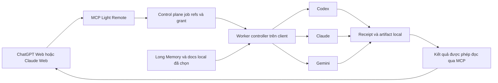

# Long Memory, extension ngữ cảnh và API Worker nhiều nhà cung cấp

Status: RESEARCH_COMPLETE / IMPLEMENTATION_NOT_STARTED
Edition: 2026-11-11, Asia/Saigon
Scope: Long Memory local-first, Chrome extension ChatGPT/Claude, Codex metadata và API Worker
Source: `work` `ad3db2f6ffaae0f9de639716e5657dd11bb40da4`; product source digest `537a0a47ba37a0a9a7a3624cb9264961de0ebcc02cd16605543948a7a73d9516`
Authority: cùng [Project Truth](../../PROJECT_TRUTH.md), [Master Checkpoint](../../MASTER_CHECKPOINT.json), [rolling Handoff](../../PROJECT_HANDOFF.md); đây là kế hoạch chuyên đề, không phải checkpoint/handoff mới

## Phạm vi Owner đã chốt

Owner xác nhận Long Memory lưu checkpoint/docs ở client và đồng bộ đã hoạt động; Claude dùng endpoint MCP cũng đã test ổn. Chrome extension và trải nghiệm ngữ cảnh xuyên session chưa được test đầy đủ. Owner chọn **nghiên cứu và ghi kế hoạch trước**, không sửa implementation, chạy CLI/provider, gọi tác vụ trả phí, build/test native hoặc deploy trong nhiệm vụ này.

Giữ Long Memory local-first và mục tiêu server chỉ chuyển tiếp nội dung; rà tất cả đường dữ liệu trước khi tuyên bố không có bản sao bền trên server. Chuẩn bị đổi tên hiển thị Codex Bridge thành **API Worker**, cho chọn và setup riêng OpenAI/Codex, Anthropic/Claude và Google/Gemini. Có luồng ChatGPT Web gọi MCP Light Remote, nhờ một worker suy luận/review, nhận kết quả rồi Agent tiếp tục; multi-worker là giai đoạn tiếp theo có kiểm soát.

Không coi báo cáo Owner là nghiệm thu của mọi artifact/profile; không suy từ source có file thành đã tích hợp/enable/physical PASS. Source review và tài liệu chính thức là bằng chứng của kế hoạch này. Các đề xuất route/schema/trạng thái dưới đây chưa tồn tại dưới tên mới.

## Hiện trạng và khoảng trống

| Phần | Đã có trong source / bằng chứng | Còn thiếu hoặc cần xác minh |
| --- | --- | --- |
| Memory local | [scope admin](../../device-agent/gold-memory-scope-admin.mjs#L111): Owner consent, scope opt-in, Home-only, transaction/sign; [Wall](../../device-agent/local-wall.mjs#L3062) gọi module tại thiết bị | Owner đã báo hoạt động; không chạy lại trên dữ liệu thật trong nghiên cứu. |
| Device sync | [gold-memory-sync.mjs:254](../../device-agent/gold-memory-sync.mjs#L254): X25519/HKDF/AES-GCM; [dedicated channel route](../../operator-host/executor-routes-device-channel.mjs#L181) tới relayRAM | Kiểm retention đầy đủ và kịch bản offline/restart bằng dữ liệu giả ở lượt test sau. |
| Extension | Hai variant phục hồi v0.2.0 local và v0.3.0 Lab; capture theo activeTab, staging thủ công | Cả hai ChatGPT-only, endpoint cố định khác nhau; chưa có Claude/restore-to-chat. |
| Codex account/model | App-server đọc account, model/list, rate limits, usage; local provider supervisor/review đã có | Desktop cold page chưa warm metadata; nút Refresh chưa force; nguồn/phạm vi usage chưa rõ với người dùng. |
| Delegation local | [supervisor](../../device-agent/gold-codex-supervisor.mjs): Owner approval, workspace boundary, SQLite CAS lease, receipts, rounds hữu hạn | Chỉ một worker; chưa có tool MCP chính thức cho Agent submit/poll/cancel một reasoning job. |
| Claude/Gemini worker | Có tài liệu CLI/SDK chính thức để xây adapter | Claude gọi Light Remote qua MCP không chứng minh Light Remote đã có Claude CLI/API worker đăng nhập và chạy được. Chưa xác minh adapter tương ứng trong current profile. |

## Long Memory: dữ liệu chính ở client, cần khép đường log MCP

Đường Owner Save ở local Wall dùng Owner auth + CSRF, explicit scope/full-context opt-in rồi ghi SQLite trên Home. Dedicated device sync truyền ciphertext qua [memory rendezvous](../../operator-host/gold-memory-rendezvous.mjs#L104), bounded RAM Map TTL120s; không thấy payload persistence PG/Redis/file trong module này. Nonce/rate infrastructure dùng RAM hoặc Redis counter đã hash với TTL, không phải business memory.

**Có đường khác chưa đáp ứng mục tiêu không lưu nội dung trên server:** [plugin Memory bridge](../../plugin-server/gold-memory-bridge.mjs#L11) mã hóa JSON thành base64url trong shell script, gọi `adapter.exec` rồi parse stdout. Base64 không phải mã hóa bảo mật. [Executor job_started](../../operator-host/executor.mjs#L903) chứa script; [stdout events](../../operator-host/executor.mjs#L619) có thể chứa body Memory read. [Event writer](../../operator-host/executor.mjs#L439) ghi `operations.jsonl`; redactor hiện lọc một số credential patterns, không loại toàn Memory body/base64. Vì vậy có khả năng có bản sao request/read trong log bền ở server.

[Gold job ledger](../../lib/gold-job-ledger.mjs#L5) cố ý chỉ giữ metadata và bỏ script/stdout; điều đó không loại bản sao event log. Không được chỉ kiểm PG rồi kết luận toàn hệ thống không lưu nội dung. Nghiên cứu không đọc live log/DB và không khẳng định một nội dung cụ thể của Owner đang còn trên server; đây là đường persistence xác nhận từ source.

Ưu tiên cao trước mở rộng context/worker:

1. Phân loại rõ memory payload, transcript, worker prompt/result/artifact và metadata. Server được giữ routing/job/grant metadata cần thiết; body Memory không đi vào durable command script/stdout/event trace.
2. Thay Memory exec wrapper bằng typed signed/device-bound content operation hoặc kênh relay phù hợp, giữ local scope/Home/consent và ký checkpoint. Control plane chỉ mang opaque refs/hash/offset cần thiết; content plane có retention/TTL rõ. Không route arbitrary shell hoặc dùng Owner cookie thay quyền Agent.
3. Loại body **trước** mọi persistence/logging/telemetry, không chỉ che UI hoặc response. Chính sách áp dụng Plugin, Operator, reverse proxy, Redis/DB/event log, exception và export diagnostics. Worker kết quả/context tương lai phải đi cùng nguyên tắc; không đưa full prompt vào generic exec logs.
4. Dùng sentinel giả riêng cho save, list/get/full-context, sync và worker result; sau test tìm sentinel ở mọi kho log/DB/cache của môi trường cô lập. Xác minh ciphertext relay biến mất đúng TTL/restart, không sửa dữ liệu thật để chứng minh.
5. Bảo toàn log/backup lịch sử hiện hữu. Nếu sau này xác minh có nội dung cũ, xử lý retention/cleanup là tác vụ riêng có kiểm kê và quyết định Owner; nghiên cứu này không xóa gì.

Server relay không đồng nghĩa không có buffer tạm thời. Mục tiêu nghiệm thu là không có **bản sao nội dung bền** trên Light Remote server ngoài chính sách đã được Owner chấp thuận; client Home/replicas và nhà cung cấp AI có phạm vi lưu riêng phải mô tả đúng.

## Extension: hợp nhất source, thêm Claude và luồng khôi phục

Source hiện tại:

- [local v0.2.0 manifest](../../extensions/light-remote-lm/manifest.json): `127.0.0.1/localhost:5491`; pending TTL chủ yếu kiểm khi event chạy.
- [Lab v0.3.0 manifest](../../extensions/light-remote-lm-abv2/manifest.json), [background](../../extensions/light-remote-lm-abv2/background.js): `100.94.184.141:15591` cố định, có alarms dọn10phút.
- [capture.js](../../extensions/light-remote-lm-abv2/capture.js#L13), popup và validator chỉ cho ChatGPT. Capture đọc DOM đã load, không lấy hidden model context hoặc các turn chưa load; media/attachments/tool data không đầy đủ. Việc loại DOM ẩn theo ancestor/duplicate chưa được bảo đảm và cần kiểm thử. Lấy một markdown block và trim có thể thiếu nhiều block hoặc thay whitespace của code.
- Luồng hiện hành là bấm Capture → review → Chrome storage.session → stage textarea trên Wall → Owner chọn scope/opt-in/Save. Extension không tự POST Save, không auto-submit chat. Wall read context cũng chỉ đưa text về textarea; chưa có restore vào composer ChatGPT/Claude.

ZIP v0.3.0 `extensions/releases/Light-Remote-LM-GoldABV2-v0.3.0.zip`: 28,095bytes, SHA256 `76a3649a4fb7704cb930f4a1912f70b80d8387128f69aff023e9a306f3fd0dcd`. Bốn file executable manifest/background/capture/popup khớp source sau chuẩn hóa CRLF/LF. Chưa kiểm toàn archive byte-identical, chưa xác minh bản Owner đang cài. README Lab/identity mismatch là tài liệu lịch sử, không chứng minh enrollment hiện nay lỗi.

Đề xuất một extension chính thức và quy trình sau:

1. Dùng một source core và provider adapters `chatgpt.com`, `claude.ai`; capture chỉ khi Owner bấm, đúng tab/conversation. Báo provider, URL, timestamp, loaded turns, omitted content và coverage; không gọi DOM snapshot là toàn bộ hidden context của model.
2. Endpoint lấy từ manifest/catalog sản phẩm cùng profile hoặc cấu hình được xác minh; mặc định ưu tiên local Wall cùng thiết bị. Host permissions/optional permissions phải khớp allowlist, không mở arbitraryURL hoặc all_urls. Verify product/device/account trước staging; không rơi âm thầm từ local sang LabARM hoặc sang Owner/scope khác.
3. Capture text theo nhiều block/role, giữ code whitespace/Unicode. Preview/redact trước Save; không tự chọn Memory scope, bật full-context opt-in hoặc tự lưu background. Transcript là dữ liệu lịch sử không tin cậy, không trở thành lệnh/ủy quyền.
4. Hợp nhất TTL/session-alarm, clear-on-close/expiry/staged, giới hạn bộ nhớ và digest/segment validation. `maybePrepare` hiện có thể được gọi từ onUpdated và fast-load path; thêm claim/generation/single-flight trước staging để không hai lần ghi đè phần Owner đang chỉnh. Đây là race source cần tái hiện, chưa coi đã xảy ra.
5. Luồng **Restore context** riêng: Owner chọn checkpoint/scope của đúng account → xem summary/docs/provenance và dung lượng → copy hoặc stage composer đúng tab → Owner tự gửi. Không ghi đè draft đang soạn, không tự submit, không auto-continue ChatGPT/Claude conversation. Nếu selector không chắc, trả Copy thủ công.
6. Lấy context vừa đủ: checkpoint summary, quyết định, việc còn dở, đường dẫn/hash docs và nguồn; full transcript là opt-in. Worker hoặc Agent chỉ đọc nội dung trong scope đã cấp. Dùng manifest context để biết file/checkpoint nào đã nạp, không hứa bộ nhớ web model tự cập nhật chỉ vì đã Save vào Light Remote.

Không tạo extension mới bằng cách chỉ đổi tên Lab package; phải bỏ endpoint profile cũ có kiểm soát và nghiệm thu provider selectors/auth/staging/readback/restore thật.

## Codex: tự tải metadata và hiển thị usage có nguồn

### Vì sao phải bấm Check account?

Desktop [NativeModuleScreens.tsx:96](../../client/desktop-v4/src/NativeModuleScreens.tsx#L96) dùng `codex.read` → [device API](../../device-agent/desktop-device-api.mjs#L61) → cached `codexPlusView` → `plus.snapshot`. [snapshot](../../device-agent/gold-codex-plus.mjs#L240) chỉ refresh khi child đã chạy và account connected/login pending. Cold Agent chưa start child nên polling snapshot không bootstrap account/models. Check account mới gọi `account()` và khởi động app-server để đọc metadata. Đây là lifecycle/UX hiện hành, không đủ kết luận credential bị hỏng.

Wall có luồng khác: vào `/codex-cli` khi module bật có initial account refresh ở [local-wall](../../device-agent/local-wall.mjs#L1956). Không suy lỗi cold Desktop sang Wall khi chưa kiểm tra.

Đề xuất tách **metadata warmup** khỏi **khởi chạy công việc**. Khi Owner đã enable provider và runtime sẵn sàng, mở trang sẽ single-flight đọc account/model/quota một lần; không tự login, cài runtime, chạy task hoặc gọi inference. Có loading, offline, needs-login, last-known và retry. Provider chưa được chọn không tự khởi động.

### Refresh và quota

[refreshMetadata](../../device-agent/gold-codex-plus.mjs#L199) throttle30s, modelTTL60s; Check account và Refresh usage đều gọi `account()`→refresh không force. Timestamp được set trước RPC nên lỗi cũng có thể suppress retry30s. Explicit Refresh cần force đúng nguồn, single-flight/backoff và generation/account fence; polling nền dùng cache hợp lý. Không cộng thêm request liên tục khi tab hidden.

Hai ảnh Owner gửi: web còn69% tuần/app đã dùng31%; web còn100% ngắn hạn/app0% đã dùng. Các cặp này khớp toán học nếu cùng account/bucket/thời điểm, không phải bằng chứng inversion. Báo cáo Owner về các lần sai khác vẫn cần kiểm chứng, nhất là stale/reset/window/account. Không đổi thành `100-usedPercent` mà giữ nhãn đã dùng.

[session view](../../device-agent/gold-codex-session-view.mjs#L67) hiện giữ usedPercent/windowDurationMins/resetsAt; UI cũng render usedPercent trực tiếp. [OpenAI Docs](https://learn.chatgpt.com/docs/app-server) định nghĩa usedPercent là đã dùng trong window và resetsAt theo Unix seconds. Kế hoạch hiển thị đồng bộ Desktop/Wall: **còn X% / đã dùng Y%**, tên phạm vi quota đúng, source+asOf, reset tuyệt đối và tương đối, timezone, stale/unknown. Dùng limitId/window thực, không hardcode mọi tài khoản thành5h/7ngày.

Phân biệt bốn loại số liệu:

| Loại | Nguồn / cách trình bày |
| --- | --- |
| Quota của provider/account/bucket | Rate-limit source; phần trăm không suy ra từ token. Không có dữ liệu thì unavailable, không gán0% đã dùng. |
| Token tác vụ/worker trên máy này | Actual turn events, task/worker IDs, phạm vi process/session và thời điểm bắt đầu rõ; tránh cộng lại cumulative/resumed/subagent events. |
| Token account lifetime | `account/usage/read.summary.lifetimeTokens`, không phải số token còn lại. Số4,796,742,182 trong ảnh không tự chứng minh quota sai. |
| Budget của nhiệm vụ | Giới hạn time/turn/token/cost Owner chọn; cost có thể là estimate, không giả là provider quota hay chặn hóa đơn tuyệt đối. |

Token parser hiện đòi đủ5 trường; runtime thiếu một field có thể làm cả report unavailable. Version/schema adapter cần giữ phần đã biết và field unknown riêng, không đoán0. `ordinaryUsageAllowed` đã parse ở Agent nhưng Desktop projection bỏ mất; credit/extra usage và multi-bucket/partial-notification semantics cần đối chiếu runtime đã pin. Test empty multi-map/fallback, primary-only updates, out-of-order account changes và reset expired trước khi khẳng định các hypothesis là bug live.

Model catalog là catalog của runtime, không luôn chứng minh entitlement. Lưu requested/actual model và reasoning effort theo capability; không chạy inference ngầm để thử quyền chỉ vì mở trang. Account refresh/notification phải invalidation đúng account, không làm lộ cached dữ liệu của account trước.

## API Worker: tên chung, adapter và quyền riêng

Đổi **nhãn UI** Codex Bridge thành **API Worker** trên Desktop, Wall, trợ giúp và trạng thái. Giữ alias/module key `codexBridge`, DB/routes/paths cũ tương thích trong giai đoạn đầu; không mass-rename làm mất preference, module flag hoặc task cũ. Chỉ migrate storage/API khi có version contract và rollback riêng. UI phải nói rõ provider đang dùng CLI tài khoản đăng nhập hay API/cloud có billing riêng.

Mỗi provider có card riêng với checkbox chọn dùng; trạng thái installed/enabled/authenticated/ready/running tách biệt. Chọn provider không đồng nghĩa đã login hoặc có quota. Card gồm setup/runtimeversion, auth method, model, reasoning nếu hỗ trợ, workspace được phép, budget, diagnostics đã lọc và nút logout/remove cấu hình đúng scope. Không yêu cầu cài mọi provider.

| Adapter đề xuất | Auth và execution | Model/output/usage |
| --- | --- | --- |
| Codex local app-server | Giữ luồng chính thức có sẵn, tách auth status và work launch; đánh giá Sign in with ChatGPT mới nếu triển khai profile sản phẩm phù hợp | model/list, thread/turn lifecycle, rateLimits/usage; model availability cần xác minh khi thực sự chạy tác vụ. |
| Claude Code CLI / Agent SDK | CLI chính thức với login của người dùng; API/cloud adapter riêng dùng credential hợp lệ | Structured JSON/stream, supportedModels/canUseTool theo SDK/runtime; effort theo model. |
| Gemini CLI | Login qua CLI chính thức, headless theo version/capability; không trích OAuth để gọi backend tự xây | JSON/stream-json stats, model/thinking theo runtime; quota không được suy từ tokens. |
| Anthropic API, Gemini API/Vertex | Optional API adapters riêng, native vault/credential chain phù hợp, billing được ghi rõ | Capabilities/model catalog/provider errors/usage riêng; không giả subscription login là API key. |

Tài liệu được đọc ngày2026-11-11: [OpenAI app-server integration](https://developers.openai.com/siwc/token-sharing-open-source/codex-app-server), [Claude SDK](https://code.claude.com/docs/en/agent-sdk/typescript), [Claude permissions](https://code.claude.com/docs/en/agent-sdk/permissions), [Gemini headless](https://geminicli.com/docs/cli/headless/), [Gemini authentication](https://geminicli.com/docs/get-started/authentication/).

Provider auth không phải một OAuth dùng chung: dùng luồng chính thức, không thu thập/chuyển subscription token sang custom backend. Điều kiện Claude về chạy binary nguyên bản và third-party login được nêu tại [legal/compliance](https://code.claude.com/docs/en/legal-and-compliance); Gemini lưu ý không piggyback CLI OAuth trong [FAQ](https://geminicli.com/docs/resources/faq/). Cần chốt adapter/auth hợp lệ trước khi thiết kế nút login, không tự copy token từ thư mục CLI. Secret không vào renderer, argv, prompt, activity log hoặc Memory.

Gemini policy `ask_user` trong headless là deny theo [Policy Engine](https://geminicli.com/docs/reference/policy-engine/); adapter phải báo blocked/needs-owner-action thay vì treo đợi prompt hoặc bật yolo. Claude dùng permission callbacks/rules khi runtime hỗ trợ. Không provider nào được nâng quyền hơn local policy; quota unknown vẫn có thể là dữ liệu chưa hỗ trợ, không đồng nghĩa hết quota.

## ChatGPT Web có thể gọi Codex hỗ trợ suy luận ngay chưa?

Current source có [observer read-only, delegated coding và review](../../device-agent/gold-codex-plus.mjs#L295), [supervisor](../../device-agent/gold-codex-supervisor.mjs#L38) và [coordinator](../../device-agent/gold-codex-coordinator.mjs). Owner có thể khởi chạy qua Desktop/Wall được authorize. Supervisor dùng một candidate, CAS lease, rounds1–5; chạy độc lập browser và DONE chỉ thành review_required. Review hiện đánh giá report/evidence được đưa vào, không mặc nhiên đã đọc code và kiểm chứng vật lý.

**Chưa có dedicated public MCP worker contract** trong Plugin tools/adapter/helper để ChatGPT Web submit reasoning job, đọc tiến độ/kết quả và cancel. Không dùng local Owner cookies hoặc gọi lén loopback API để bù. Legacy `gold-codex-api.mjs` còn source nhưng route Wall đã410; project-continuity RPC chỉ proposal/nonexecution, không phải engine multi-worker.

Đề xuất luồng dùng đúng ý định Owner:

- Bắt đầu bằng **reasoning/review read-only**: Agent chọn provider/model và context refs đã cấp; nhận jobId/queued state, poll/read result, rồi tự tổng hợp và tiếp tục nhiệm vụ. Không tự đẩy turn vào ChatGPT Web. Read-only ở đây không có nghĩa không gửi context tới provider; context export cần nằm trong phạm vi Owner cho phép.
- Contract mới có start/status/events/result/cancel và capability discovery; tên/schema cụ thể sẽ được review khi implementation. Bind account/device/Agent session/grant/workspace/context snapshot/version; idempotency và receipts thật. Không chuyển Desktop Owner login thành Agent execution grant.
- Coding/edit là mode khác, workspace/sandbox/approval riêng. Provider prompt không thể mở thêm network, shell, filesystem hoặc nâng quyền. Approved task definition và local policy là giới hạn cuối.
- Result phân biệt completed/failed/interrupted/needs-owner/unknown; gồm summary, evidence refs, requested/actual model, scope, timestamps, usage và artifact manifest. Không coi recommendation DONE là project/task đã nghiệm thu.
- Worker outputs/prompt/context giữ ở client trong scope cần thiết. Server control metadata và content relay phải theo mục retention ở trên; không đưa toàn context vào command script/stdout của generic jobs.

## Multi-worker: khả thi, chưa có trong current implementation

Current plus giữ một child/currentTurn/working guard; supervisor có running boolean và LIMIT1. `CONTINUE_SECTION_B` là nhãn quyết định, không sinh workerB. Vì vậy không nên chỉ đổi UI thành multi-worker rồi cho là đã có scheduler.

Đề xuất một controller và provider adapters có interface capabilities/auth/model/launch/events/cancel/result. Mỗi worker có job/worker/parent IDs, provider account, role, context snapshot, budget và lease riêng. Concurrency được Owner đặt và hệ thống giảm theo CPU/RAM/quota; mặc định triển khai nhỏ, đo thực tế trước khi tăng.

Có thể chạy nhiều reader/reviewer song song trên snapshot immutable, **một writer/lease cho cùng workspace**. Kết quả là evidence/patch artifact để coordinator tích hợp; không cho nhiều worker sửa cùng file âm thầm. Branch/worktree mới vẫn theo quyền Owner hiện hành; kế hoạch này không cấp quyền tạo branch tự động.

Budget có mức per-worker và tổng tác vụ, giới hạn thời gian/turn/recursion và stop rõ. Một worker lỗi/hết quota không được tự chuyển provider/account với context chưa được cho phép. Chỉ cancel process tree của worker tương ứng, không dừng Agent/session khác; reconnect/crash không replay coding unknown. Scheduler cần CAS/fencing/recovery, không chỉ Promise.all.

Long Memory chứa checkpoint/context/artifact refs để chuyển session có chọn lọc. Không cho extension capture hay worker result tự thành lệnh điều phối; Agent chính quyết định sử dụng evidence và Owner giữ quyền xác nhận trạng thái hoàn thành/các thao tác đã yêu cầu duyệt.

## Lộ trình và kế hoạch test — chưa chạy

| Bước | Kết quả cần có | Kiểm thử có ý nghĩa |
| --- | --- | --- |
| 1. Retention và contract | Đóng đường MCP Memory body vào script/stdout/event log; một extension/profile chuẩn; provider boundary | Sentinel qua Memory save/read/full-context/sync; payload không xuất hiện trong log/PG/Redis ngoài buffer TTL được định nghĩa; kiểm crash/restart. |
| 2. Extension capture/restore | ChatGPT và Claude adapters, coverage/digest, TTL, single staging, manual Save/Restore | DOM fixtures nhiều block/code/Unicode/hidden/virtualized/oversize; fake Chrome alarms/tab lifecycle; duplicate onUpdated không ghi đè redaction/draft. |
| 3. Metadata/usage UX | Auto warm enabled provider, explicit force refresh, timestamp/scope/unknown và account invalidation | Cold Agent đã login; offline/expiredlogin; request within30s; reset passed; used/remaining; partial token fields, multi-bucket/stale/accountswitch. Không inference để test metadata. |
| 4. Một worker qua MCP | Read-only reasoning job end-to-end trên exact device/session/context | Structured stub trước; rồi Owner cho phép một live provider call có budget, poll/cancel/results và không dùng loopback bypass. |
| 5. Claude/Gemini adapters | Setup từng provider, official login/API options, model/usage/approval capabilities | SDK/CLI version fixtures; auth unavailable/quotaunknown/headlessdeny; một live job nhỏ từng provider sau khi Owner chọn tài khoản và ngân sách. |
| 6. Multi-worker | Bounded scheduler/readers/writer lease/recovery/artifacts | Readerparallel, writerconflict, budgetsum, crash/lateevent/fencing/cancel đúng process; no replay/double usage, context/account isolation. |

Node selftests hiện có là nguồn test nền: `selftest-gold-lm-extension-abv2.mjs`, các `selftest-gold-memory-*`, `selftest-gold-codex-plus.mjs`, supervisor/coordinator và Desktop CodexControls tests. Chưa chạy trong nghiên cứu; không suy source test tồn tại thành PASS. Mọi thay đổi implementation cần meaningful isolated tests và exact-source CI theo AGENTS ở lượt được yêu cầu.

Physical Chrome acceptance riêng: load unpacked trong profile test → login đúng local Wall → bật Memory/chọn scope/opt-in → capture câu chuyện ChatGPT/Claude giả → review/redact/manual Save → readback checkpoint ký → sync client thứ hai đã cấp quyền → mở chat mới/manual Restore → xác minh nội dung và draft không mất. Test logged-out redirect/module-off/CSRF/cross-account/Home mismatch; không auto-select scope hoặc gửi chat. Không cài/đổi extension trên profile Owner trong nhiệm vụ hiện tại.

Mọi test live worker phải có provider được chọn, auth sẵn có hợp lệ và budget cụ thể; không login/cài CLI hoặc tiêu quota chỉ để nghiên cứu. Native installer/tray/X/Agent/ConPTY/upgrade/rollback dev6 và [RMv2 typing/cursor/GPU plan](RMV2_RESPONSIVENESS_CURSOR_GPU_PLAN.md) vẫn là backlog riêng cho lần build được Owner yêu cầu; không bị bỏ khỏi checkpoint.

## Kết quả nhiệm vụ nghiên cứu

Đã có source map, lỗi/gap rõ, ranh giới retention và thiết kế extension/API Worker/multi-worker/test. Chưa đổi nhãn UI, thêm provider login, sửa account refresh, extension hoặc worker implementation. Chưa có Chrome/provider/native physical test hay benchmark mới. Last verified Lab vẫn8e0d932/dev5, main8ac6273 và máy Owner không đổi.

Chỉ docs/checkpoint gates được chạy khi xuất bản kế hoạch. RMv2 typing đã xuất bản riêng ởad3db2f, CI76 documentation-only PASS; core/Desktop/Windows/native dependency jobs skipped. Sau khi Owner yêu cầu triển khai, ưu tiên retention + một extension chuẩn + metadata UX, sau đó một MCP reasoning worker trước khi mở nhiều provider/worker song song.
