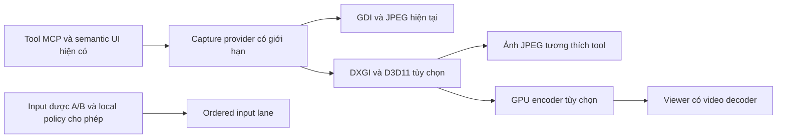

# RM v2 — cursor nguyên bản, phản hồi nhanh và GPU tùy chọn

Status: draft / RESEARCH_COMPLETE_IMPLEMENTATION_NOT_STARTED
Edition: 2026-11-11, Asia/Saigon
Scope: Windows RM v2; giữ các tool, semantic UI, A/B và local policy hiện tại
Authoritative source: GitHub `work` `764e1d7ce7670c9e95690fca26b58dd2e3c86f02`, tree `41a48add6e01f3e4f6d28271a59b77f92a8acaca`
Supersedes: none; bổ sung kế hoạch, không phải handoff/checkpoint thứ hai

## Kết luận và giới hạn của nghiên cứu

Nên làm theo thứ tự: bỏ can thiệp system cursor, sửa input contract/timing và đo độ trễ, tối ưu capture hiện tại, bổ sung GPU capture, cuối cùng mới thêm video tương tác tùy chọn. Không thay toàn bộ RM v2 bằng Sunshine và không gộp GPU/video thành điều kiện để sửa chuột.

Đây là đọc source và tài liệu chính thức. Không sửa implementation, chạy benchmark, điều khiển máy Owner, restore cursor thật, build native, cài app hoặc deploy. Các vấn đề chắc chắn từ source được tách khỏi giả thuyết cần tái hiện. Không có số đo latency/FPS mới và không khẳng định máy người báo lỗi đang dùng đúng source này.

Snapshot Git ZIP đã xác minh SHA-256 `b5b9e07a77902ddaf3980ea69f1bf67bec17813ff054412ca4f084918c683d86`, 9,602,165 bytes. Các file native/bridge/input/Agent/Operator liên quan được đối chiếu byte với snapshot trước; không đổi trong đợt thiết kế installer. GitHub `main` thực tế `8ac627342e7caea097d551978ec0ed5b3c8bbc4a` có cùng `SystemCursorOverride.cs`, SHA-256 `6e9303b18465298f5fee34a8f732250f82d4fdf022c8092485e973bed506500b`.

## Báo lỗi system cursor còn đúng đến đâu?

| Quan sát source hiện tại | Ý nghĩa |
| --- | --- |
| [SystemCursorOverride.cs:30](../../client/windows-native/GptOperator.RealRemoteV2/SystemCursorOverride.cs#L30): danh sách thực thi chỉ `OCR_NORMAL` | Đã giữ lại resize, I-beam, hand, wait. Việc còn khai báo các hằng resize không có nghĩa đang thay chúng. Báo lỗi thay toàn bộ resize mô tả một phiên bản cũ hơn. |
| [RobotContext.cs:43](../../client/windows-native/GptOperator.RealRemoteV2/RobotContext.cs#L43): constructor không Acquire | Không còn thay cursor ngay lúc khởi tạo RobotContext. |
| [RobotContext.cs:154](../../client/windows-native/GptOperator.RealRemoteV2/RobotContext.cs#L154): visual attach Acquire, lease cursor 30 giây | Chỉ mở phiên quan sát vẫn đổi normal cursor toàn Windows. Lifetime cursor không khớp lifetime visual session. |
| [RobotContext.cs:238](../../client/windows-native/GptOperator.RealRemoteV2/RobotContext.cs#L238): input Acquire với lease 5 giây | `visualSessions: 0` và `osCursorOverridden: true` vẫn có thể xuất hiện sau input; không tự chứng minh leak vĩnh viễn. |
| [Program.cs:12](../../client/windows-native/GptOperator.RealRemoteV2/Program.cs#L12), [SystemCursorOverride.cs:35](../../client/windows-native/GptOperator.RealRemoteV2/SystemCursorOverride.cs#L35) | `--restore-cursors` chạy trong process khác; không clear lease/trạng thái hoặc lưu disable preference ở robot đang sống. Status internal có thể vẫn true sau external restore và một lần Acquire sau này có thể thay lại. |
| [SystemCursorOverride.cs:139](../../client/windows-native/GptOperator.RealRemoteV2/SystemCursorOverride.cs#L139) | Restore bỏ qua Win32 BOOL; CLI exit0 chưa phải bằng chứng restore thành công. |
| [RobotContext.cs:54](../../client/windows-native/GptOperator.RealRemoteV2/RobotContext.cs#L54) | Tắt `LIGHT_REMOTE_RM_ANIMATED_GLOW` chỉ tắt overlay, không vô hiệu hóa `SetSystemCursor`. |

Microsoft mô tả [SetSystemCursor](https://learn.microsoft.com/en-us/windows/win32/api/winuser/nf-winuser-setsystemcursor) là thay nội dung system cursor theo role. Vì vậy chỉ giới hạn override vào phiên active vẫn không đáp ứng yêu cầu giữ cursor gốc; cần bỏ API này khỏi đường hoạt động bình thường.

Một race có thể xảy ra ở timer renewal: callback cũ đã được queue có thể release lease sau lần gia hạn mới vì chưa có deadline/generation guard. Đây là giả thuyết từ source, chưa tái hiện. Ngoài ra keyboard và UIA action chưa đi qua cùng indicator với physical move/click; không được dùng riêng số visual sessions để suy ra đang điều khiển.

## Thiết kế cursor và thông báo đang dùng máy

**Cursor gốc do Windows quản lý hoàn toàn.** Không đổi shape, màu, hotspot, pointer speed, trails, scheme hay kích thước accessibility; không thay riêng normal/resize/I-beam/custom cursor. Badge là một cửa sổ overlay riêng, không phải cursor thứ hai.

Đề xuất state chung cho mọi input: `idle`, `observing`, `controlling`, `paused-local-input`, `disconnected`. State ràng buộc đúng device/session/lease; trạng thái process đang chạy, Owner đăng nhập hoặc một lần status read không được bật badge AI. Frame read/observation không đồng nghĩa có quyền điều khiển.

- Khi thực sự điều khiển: hiện nhãn nhỏ **AI** dưới đuôi cursor, cộng viền glow mỏng trên màn hình bị điều khiển. Keyboard, semantic invoke và drag cập nhật cùng state.
- Chỉ quan sát: không badge AI điều khiển; nếu cần thông báo đang chia sẻ màn hình thì dùng indicator quan sát riêng, mô tả đúng là đang xem.
- Local Owner thao tác: ưu tiên input thật, dừng đường di/drag remote có thể hủy, nhả đúng nút do RM giữ và chuyển paused. Không giành lại chuột trong vòng lặp. Phân biệt input do RM phát bằng marker, không coi mọi injected input của app khác là input Owner.
- Dùng hạ tầng layered/click-through/noactivate hiện có trong [CursorGlowOverlay.cs](../../client/windows-native/GptOperator.RealRemoteV2/CursorGlowOverlay.cs). Badge không nhận focus, hit test hoặc che click/resize; lấy kích thước/hotspot cursor thật, offset theo DPI và flip/clamp gần mép màn hình.
- Viền nên là bốn dải mỏng, fade nhẹ khi đổi state; không dùng bề mặt fullscreen để hit-test hoặc pulse liên tục. Tôn trọng high contrast/reduced motion. Timer hiện có 16ms vẫn wake khi hidden; thiết kế mới stop/start theo state, cập nhật vị trí tối đa theo refresh cần thiết.
- Overlay cục bộ nên được loại khỏi capture khi backend hỗ trợ và đã xác minh để tránh tự gây frame changes/OCR noise. [WDA_EXCLUDEFROMCAPTURE](https://learn.microsoft.com/en-us/windows/win32/api/winuser/nf-winuser-setwindowdisplayaffinity) là ứng viên cho top-level window của chính process; phải kiểm tra với GDI/DXGI/WGC, không hứa hoạt động trên mọi backend. Nếu remote viewer cần badge thì render từ metadata phía viewer.
- Detach, mất kết nối, revoke, lock, desktop switch và crash phải dừng indicator/control lease. Dùng monotonic deadline + generation để callback cũ không hủy state mới. Không dùng thời gian treo 30 giây thay cho session authority.

Giữ `--restore-cursors` cho recovery legacy. Bổ sung yêu cầu IPC tới robot đang sống để clear state và vô hiệu hóa override legacy cho lifetime/settings, trả kết quả Win32 thật. Khi migrate, chỉ restore legacy theo ownership/state đã xác minh; không reload cursor scheme vô điều kiện mỗi startup và làm gián đoạn app khác. Backend mới không gọi `SetSystemCursor` nên restore xong không có đường tự thay lại.

## Những điểm gây chậm và cảm giác chuột không sát thực

| Mức | Bằng chứng source | Đề xuất |
| --- | --- | --- |
| Bug contract | [tools.mjs:723](../../plugin-server/tools.mjs#L723) nhận `durationMs/steps`, nhưng [real-remote-input.cjs:60](../../lib/real-remote-input.cjs#L60) bỏ cả hai ở move. Normalize chạy ở Operator và Agent. [native-desktop.mjs:66](../../lib/native-desktop.mjs#L66) nhận lại default90ms/8steps. | Giữ/validate tham số qua toàn tuyến; `0` phải giữ đúng nghĩa. Không mở rộng quyền input. |
| Timing chủ động | [NativeInput.cs:62](../../client/windows-native/GptOperator.RealRemoteV2/NativeInput.cs#L62) di point-to-point cubic ease-out90ms; click tọa độ chèn move, rồi [Click:114](../../client/windows-native/GptOperator.RealRemoteV2/NativeInput.cs#L114) chờ35ms hover+40ms down/up. | Khoảng165ms được lập trình trước mạng/queue/ảnh. Thêm chế độ Precision/Responsive; Smooth opt-in. Giữ quirk Paint đã có bằng profile/compatibility fallback, không xóa75ms đại trà. |
| Bug explicit0 | [operator-agent.mjs:434](../../device-agent/operator-agent.mjs#L434) dùng `Number(minIntervalMs)||250`. | `0` bị thành250ms; sửa nullish/default đúng và validate. Chỉ observe path bị throttle, direct frame không bị giới hạn tương tự; không gọi toàn RM là4FPS. |
| Queue | [RobotRpcServer.cs:39](../../client/windows-native/GptOperator.RealRemoteV2/RobotRpcServer.cs#L39) await handler rồi mới đọc request kế tiếp. Capture, UIA, text/drag/sleep chung tuyến. | Tách capture/UIA worker khỏi ordered input lane; stop/cancel/status được phản hồi nhanh. Không Task.Run mọi input vì sẽ sai thứ tự và thread affinity. |
| Capture CPU | [DesktopVisual.cs:104](../../client/windows-native/GptOperator.RealRemoteV2/DesktopVisual.cs#L104): full Bitmap/CopyFromScreen, bicubic resize, JPEG có thể encode nhiều mức, SHA/base64. | Reuse buffers/cached codec, ROI/latest-frame cache, tránh encode khi không đổi, giới hạn queue frame. |
| Unchanged muộn | [operator-agent.mjs:507](../../device-agent/operator-agent.mjs#L507) chỉ bỏ base64 sau native capture+encode+hash+IPC. | Bỏ việc không cần làm ở capture provider sớm hơn; không nhầm tiết kiệm mạng với tiết kiệm CPU. |
| Capability drift | Plugin nhận đến7680×4320/q100, native clamp1280×720/q70, default960×540/q50. | Công bố effective limits/backend trong capability/response; client không kỳ vọng chất lượng chưa được hỗ trợ. |

Hiện tại Move kết thúc tại tọa độ đích; chưa có bằng chứng runtime bị lệch1–5px. Cảm giác lệch có thể do easing, độ trễ ảnh, scale/DPI, frame cũ hoặc quỹ đạo tổng hợp. Cần đo tách biệt trước khi sửa mapping. Đã có screen-local→virtual, negative origin, topology ID, DPI và inputMapping trong DesktopVisual; phải giữ các nền tảng này.

Đề xuất bổ sung mapping rõ `frame / screen / virtual` với frameSeq/topology version và phép biến đổi thực tế đã trả về. Point từ ảnh resize phải được map về pixel màn hình trước khi gửi; reject ảnh stale khi hotplug/DPI/rotation thay đổi. Không áp lại DPI một lần nữa nếu tọa độ đã là physical pixels. Nếu tương lai cần chuột người dùng1:1 thì thêm relative/path mode riêng, không gọi cubic point-to-point hiện tại là raw mouse forwarding.

Các tối ưu đã có cần giữ: helper on-demand/reuse, retained visual lease, semantic delta/cache, signed duplex, quota/dedupe/audit và local deny. Heartbeat60s là liveness, `waitMs7000` là giới hạn đợi, không phải mỗi thao tác ngủ60s/7s. Không bỏ kiểm tra quyền hoặc tự retry/replay click/key để lấy tốc độ.

## GPU giống Sunshine có phù hợp không?

Có. Trên Windows nên thử **DXGI Desktop Duplication + D3D11**. [Microsoft](https://learn.microsoft.com/en-us/windows/win32/direct3ddxgi/desktop-dup-api) cung cấp GPU surfaces, dirty/move rectangles và thông tin cursor riêng. [Sunshine](https://docs.lizardbyte.dev/projects/sunshine/master/md_docs_2configuration.html#capture) cũng có Windows `ddx`; tùy chọn NvFBC trong tài liệu đó là Linux, không phải lựa chọn Windows mặc định.

**Bước GPU thứ nhất — tăng tốc tool hiện có:** thêm provider được chọn bằng `auto / gdi / dxgi` (tên cấu hình đề xuất, chưa có implementation). Chụp/crop/resize trên GPU, dùng dirty metadata để tránh encode ảnh không đổi, cuối cùng vẫn xuất JPEG đúng contract MCP. JPEG có thể còn cần CPU/readback: không quảng cáo toàn pipeline zero-copy. Giữ GDI fallback và chọn GDI mặc định cho đến khi đủ nghiệm thu.

**Bước GPU thứ hai — video nâng cao tùy chọn:** DXGI texture → resize/chuyển màu GPU → NVENC / Intel QuickSync / AMD AMF → H.264 → viewer. HEVC/AV1 chỉ bật khi hai đầu support. Probe codec/encoder thật, dùng profile tương tác low-latency, hàng đợi ngắn và không tích lũy frame cũ. [NVENC guide](https://docs.nvidia.com/video-technologies/video-codec-sdk/13.0/nvenc-video-encoder-api-prog-guide/index.html) mô tả DirectX input và tuning; [Sunshine encoder config](https://docs.lizardbyte.dev/projects/sunshine/master/md_docs_2configuration.html#encoder) liệt kê các backend phần cứng.

Video liên tục cần viewer thực và media transport riêng; không nhét H.264 liên tục vào tool JPEG/base64 rồi kỳ vọng ChatGPT tự thành Moonlight. WebRTC là ứng viên cho media/data, signaling phải bind đúng device/session/grant, có reconnect/revoke/expiry và relay fallback. Đây là đề xuất kiến trúc, chưa chọn dependency hoặc triển khai endpoint. Không mở cổng public mới hoặc pairing song song làm bypass A/B.

Tách media khỏi input: motion có seq/timestamp, coalesce latest-wins chỉ giữa các move độc lập; không vượt qua click/drag/key barriers. Button-down/up, key-down/up và click reliable/ordered. Không replay input sau reconnect. Viewer có thể hiển thị cursor position/shape từ metadata độc lập video; phân biệt vị trí dự đoán với actual acknowledged, không vẽ double cursor. Với tool AI, ưu tiên thao tác semantic và batch có guard khi phù hợp; GPU không giảm thời gian model suy luận hay vòng gọi MCP.

DXGI device phải trên adapter nối với output; laptop hybrid có thể cần copy giữa GPU. [DuplicateOutput](https://learn.microsoft.com/en-us/windows/win32/api/dxgi1_2/nf-dxgi1_2-idxgioutput1-duplicateoutput) có các lỗi unsupported, access-lost/session-disconnected và giới hạn duplication: recreate/fallback có backoff, không lặp khởi tạo vô hạn. Secure desktop/lock phải fail closed, không nâng quyền để vượt giới hạn. Kiểm tra headless/RDP/hotplug/rotation, HDR→SDR và GPU reset; không hứa zero-copy hoặc60FPS trên mọi máy.

[Windows.Graphics.Capture](https://learn.microsoft.com/en-us/windows/apps/develop/media-authoring-processing/screen-capture) là provider tương lai phù hợp window capture; kiểm tra IsSupported, consent, HDR và frame lifetime. Sunshine ghi WGC beta không tương thích với chính Sunshine service; không suy rộng giới hạn đó sang mọi service Windows. Border capture của hệ điều hành không thay thế indicator đang điều khiển AI.

Sunshine hiện dùng [GPLv3](https://raw.githubusercontent.com/LizardByte/Sunshine/master/LICENSE). Kế hoạch này học kiến trúc qua tài liệu; không copy/link/bundle source Sunshine. Nếu chọn tích hợp source/binary sau này thì cần đánh giá license và cách phân phối riêng trước khi chốt dependency.

## Thứ tự thực hiện đề xuất

| Giai đoạn | Phạm vi | Điều kiện hoàn thành |
| --- | --- | --- |
| 1 — cursor và input | Bỏ override normal path; badgeAI/viền; local takeover; restore legacyIPC; giữ duration/steps/explicit0; instrument timeline | Windows cursor nguyên bản mọi role, restore còn hiệu lực khi robot sống, không giành chuột; contract end-to-end đúng. |
| 2 — phản hồi trên cơ chế hiện tại | Precision/Responsive, ordered input/cancel, capture cache/ROI/buffer reuse, effective capabilities, mapping/frame freshness | So sánh trước/sau cùng máy/mạng/cảnh; p95 input/queue/frame-age tốt hơn, không mất click/key-up hoặc giảm độ chính xác. |
| 3 — GPU capture tùy chọn | DXGI provider + GPU preprocessing + JPEG contract, fallbackGDI | NVIDIA/Intel/AMD/hybrid matrix, recovery và không GPU vẫn dùng đượcRM v2 cũ. |
| 4 — video tương tác tùy chọn | Encoder + authorized viewer + media/input lanes | Auth/revoke/local deny không đổi; đo input-to-visible, frame age và mạng mất gói; không chỉ báo FPS. |

Không gộp cả bốn giai đoạn vào một thay đổi khó rollback. Mỗi bước implementation sau này cần checkpoint/tag và atomic docs theo AGENTS. Hiện chưa bước nào được triển khai bởi nhiệm vụ nghiên cứu này.

## Đo và nghiệm thu cho lần được yêu cầu build/test

Gắn trace ID qua nhận request → queue → native apply → capture → resize → encode → gửi → decode/display/visible-change. Dùng monotonic durations trong từng process; không trừ wall-clock hai máy nếu chưa đồng bộ. Báo p50/p95/p99, queue depth, frame age, dropped/coalesced frames, CPU/GPU và bytes. Tách tool roundtrip/model time khỏi input latency tại máy đích.

1. Idle/observe/control/keyboard/UIA/paused/disconnected; tất cả cursor roles, custom scheme, large cursor; restore khi robot còn sống; reconnect/crash/lease expiry không thay lại scheme.
2. Tiny moves1–5px và long moves, duration0/steps1 đi qua đủ Plugin→Operator→Agent→native; verify actual endpoint; drag ordering, local takeover giữa drag, không kẹt button/key.
3. Mixed DPI100/150/200%, màn hình originâm, rotation/hotplug, frame resize và stale topology; kiểm tra frame→screen mapping và click target thật.
4. BusyUIA/longtext/capture đồng thời; stop/cancel/status không kẹt sau frame encoder; queue bounded; không retry mutation sau timeout/reconnect.
5. Badge/viền không chặn resize/focus/fullscreen, highcontrast/reducedmotion, overlay không gây vòng lặp capture changes; CPUidle khi indicator tắt.
6. GPU không support, hybridadapter, RDP/headless/lock/unlock, display/device lost/HDR; fallback/recreate hữu hạn, UI báo đúng backend/error, không nâng quyền.
7. Với video: bitrate/packetloss/jitter/relay, codec negotiation, frameage và input-to-visible p95; click/key reliable trong khi bỏ frame/move cũ có kiểm soát.
8. Cùng lượt build sau này vẫn chạy checklist native installer/tray/font/X/Agent/ConPTY/upgrade/uninstall/rollback đang ghi ở [handoff](../../PROJECT_HANDOFF.md), không suy ra chúng PASS từ nghiên cứu RM này.

Không có build/test được chạy trong nghiên cứu. CI72 đã xác minh cancelled; CI73 trước đó chỉ docs gates, native/core jobs skipped. Dev6 chỉnh cuối0397d871 vẫn chưa được native acceptance. Lab vẫn dev5 nguồn8e0d932; main8ac6273, máy Owner và runtime cũ không đổi.

## Điểm nối tiếp

Đọc kế hoạch này cùng [Project Truth](../../PROJECT_TRUTH.md), [Master Checkpoint](../../MASTER_CHECKPOINT.json) và [rolling handoff](../../PROJECT_HANDOFF.md). Chờ chỉ thị implementation/build riêng; đề xuất ưu tiên bắt đầu bằng cursor nguyên bản + input contract/timing, đo baseline trước khi quyết định backendGPU mặc định. Không tự build, deploy hoặc cài bản thử từ kết quả nghiên cứu.
