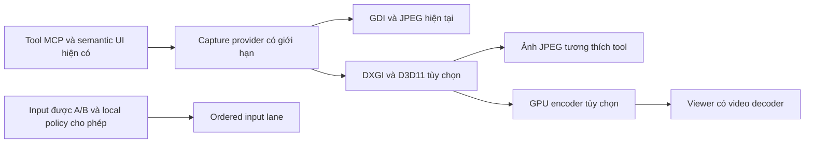

# RM v2 — cursor nguyên bản, phản hồi nhanh và GPU tùy chọn

Status: PHASE2A_SOURCE_IMPLEMENTED_NATIVE_CI_PENDING_OWNER_UAT_DEFERRED
Edition: 2026-11-11, Asia/Saigon
Scope: Windows RM v2, đối chiếu typing macOS; giữ các tool, semantic UI, A/B và local policy hiện tại
Authoritative source: GitHub `work` `764e1d7ce7670c9e95690fca26b58dd2e3c86f02`, tree `41a48add6e01f3e4f6d28271a59b77f92a8acaca`
Supersedes: none; bổ sung kế hoạch, không phải handoff/checkpoint thứ hai

## Kết luận và giới hạn của nghiên cứu

Nên làm theo thứ tự: bỏ can thiệp system cursor, sửa input contract/timing và đo độ trễ, tối ưu capture hiện tại, bổ sung GPU capture, cuối cùng mới thêm video tương tác tùy chọn. Không thay toàn bộ RM v2 bằng Sunshine và không gộp GPU/video thành điều kiện để sửa chuột.

Đây là đọc source và tài liệu chính thức. Không sửa implementation, chạy benchmark, điều khiển máy Owner, restore cursor thật, build native, cài app hoặc deploy. Các vấn đề chắc chắn từ source được tách khỏi giả thuyết cần tái hiện. Không có số đo latency/FPS mới và không khẳng định máy người báo lỗi đang dùng đúng source này.

Snapshot Git ZIP đã xác minh SHA-256 `b5b9e07a77902ddaf3980ea69f1bf67bec17813ff054412ca4f084918c683d86`, 9,602,165 bytes. Các file native/bridge/input/Agent/Operator liên quan được đối chiếu byte với snapshot trước; không đổi trong đợt thiết kế installer. GitHub `main` thực tế `8ac627342e7caea097d551978ec0ed5b3c8bbc4a` có cùng `SystemCursorOverride.cs`, SHA-256 `6e9303b18465298f5fee34a8f732250f82d4fdf022c8092485e973bed506500b`.

## Báo lỗi system cursor còn đúng đến đâu?

| Quan sát source hiện tại | Ý nghĩa |
| --- | --- |
| [SystemCursorOverride.cs:30](../../client/windows-native/GptOperator.RealRemoteV2/SystemCursorOverride.cs#L30): danh sách thực thi chỉ `OCR_NORMAL` | Đã giữ lại resize, I-beam, hand, wait. Việc còn khai báo các hằng resize không có nghĩa đang thay chúng. Mô tả thay toàn bộ resize không khớp source hiện tại; có thể thuộc một phiên bản cũ hơn. Artifact trên máy người báo lỗi chưa được xác minh. |
| [RobotContext.cs:43](../../client/windows-native/GptOperator.RealRemoteV2/RobotContext.cs#L43): constructor không Acquire | Không còn thay cursor ngay lúc khởi tạo RobotContext. |
| [RobotContext.cs:154](../../client/windows-native/GptOperator.RealRemoteV2/RobotContext.cs#L154): visual attach Acquire, lease cursor 30 giây | Chỉ mở phiên quan sát vẫn đổi normal cursor toàn Windows. Lifetime cursor không khớp lifetime visual session. |
| [RobotContext.cs:238](../../client/windows-native/GptOperator.RealRemoteV2/RobotContext.cs#L238): input Acquire với lease 5 giây | `visualSessions: 0` và `osCursorOverridden: true` vẫn có thể xuất hiện sau input; không tự chứng minh leak vĩnh viễn. |
| [Program.cs:12](../../client/windows-native/GptOperator.RealRemoteV2/Program.cs#L12), [SystemCursorOverride.cs:35](../../client/windows-native/GptOperator.RealRemoteV2/SystemCursorOverride.cs#L35) | `--restore-cursors` chạy trong process khác; không clear lease/trạng thái hoặc lưu disable preference ở robot đang sống. Status internal có thể vẫn true sau external restore và một lần Acquire sau này có thể thay lại. |
| [SystemCursorOverride.cs:139](../../client/windows-native/GptOperator.RealRemoteV2/SystemCursorOverride.cs#L139) | Restore bỏ qua Win32 BOOL; CLI exit0 chưa phải bằng chứng restore thành công. |
| [RobotContext.cs:54](../../client/windows-native/GptOperator.RealRemoteV2/RobotContext.cs#L54) | Tắt `LIGHT_REMOTE_RM_ANIMATED_GLOW` chỉ tắt overlay, không vô hiệu hóa `SetSystemCursor`. |

Microsoft mô tả [SetSystemCursor](https://learn.microsoft.com/en-us/windows/win32/api/winuser/nf-winuser-setsystemcursor) là thay nội dung system cursor theo role. Vì vậy chỉ giới hạn override vào phiên active vẫn không đáp ứng yêu cầu giữ cursor gốc; cần bỏ API này khỏi đường hoạt động bình thường.

Một race có thể xảy ra ở timer renewal: callback cũ đã được queue có thể release lease sau lần gia hạn mới vì chưa có deadline/generation guard. Đây là giả thuyết từ source, chưa tái hiện. Ngoài ra keyboard và UIA action chưa đi qua cùng indicator với physical move/click; không được dùng riêng số visual sessions để suy ra đang điều khiển.

## Thiết kế cursor và thông báo đang dùng máy

**Cursor gốc do Windows quản lý hoàn toàn.** Không đổi shape, màu, hotspot, pointer speed, trails, scheme hay kích thước accessibility; không thay riêng normal/resize/I-beam/custom cursor. Badge là một cửa sổ overlay riêng, không phải cursor thứ hai.

Đề xuất state chung cho mọi input: `idle`, `observing`, `controlling`, `paused-local-input`, `disconnected`. State ràng buộc đúng device/session/lease; trạng thái process đang chạy, Owner đăng nhập hoặc một lần status read không được bật badge AI. Frame read/observation không đồng nghĩa có quyền điều khiển.

- Khi thực sự điều khiển: hiện nhãn nhỏ **AI** dưới đuôi cursor, cộng viền glow mỏng trên màn hình bị điều khiển. Keyboard, semantic invoke và drag cập nhật cùng state.
- Chỉ quan sát: không badge AI điều khiển; nếu cần thông báo đang chia sẻ màn hình thì dùng indicator quan sát riêng, mô tả đúng là đang xem.
- Local Owner thao tác: ưu tiên input thật, dừng đường di/drag remote có thể hủy, nhả đúng nút do RM giữ và chuyển paused. Không giành lại chuột trong vòng lặp. Phân biệt input do RM phát bằng marker, không coi mọi injected input của app khác là input Owner.
- Dùng hạ tầng layered/click-through/noactivate hiện có trong [CursorGlowOverlay.cs](../../client/windows-native/GptOperator.RealRemoteV2/CursorGlowOverlay.cs). Badge không nhận focus, hit test hoặc che click/resize; lấy kích thước/hotspot cursor thật, offset theo DPI và flip/clamp gần mép màn hình.
- Viền nên là bốn dải mỏng, fade nhẹ khi đổi state; không dùng bề mặt fullscreen để hit-test hoặc pulse liên tục. Tôn trọng high contrast/reduced motion. Timer hiện có 16ms vẫn wake khi hidden; thiết kế mới stop/start theo state, cập nhật vị trí tối đa theo refresh cần thiết.
- Overlay cục bộ nên được loại khỏi capture khi backend hỗ trợ và đã xác minh để tránh tự gây frame changes/OCR noise. [WDA_EXCLUDEFROMCAPTURE](https://learn.microsoft.com/en-us/windows/win32/api/winuser/nf-winuser-setwindowdisplayaffinity) là ứng viên cho top-level window của chính process; phải kiểm tra với GDI/DXGI/WGC, không hứa hoạt động trên mọi backend. Nếu remote viewer cần badge thì render từ metadata phía viewer.
- Detach, mất kết nối, revoke, lock, desktop switch và crash phải dừng indicator/control lease. Dùng monotonic deadline + generation để callback cũ không hủy state mới. Không dùng thời gian treo 30 giây thay cho session authority.

Giữ `--restore-cursors` cho recovery legacy. Bổ sung yêu cầu IPC tới robot đang sống để clear state và vô hiệu hóa override legacy cho lifetime/settings, trả kết quả Win32 thật. Khi migrate, chỉ restore legacy theo ownership/state đã xác minh; không reload cursor scheme vô điều kiện mỗi startup và làm gián đoạn app khác. Backend mới không gọi `SetSystemCursor` nên restore xong không có đường tự thay lại.

## Những điểm gây chậm và cảm giác chuột không sát thực

| Mức | Bằng chứng source | Đề xuất |
| --- | --- | --- |
| Bug contract | [tools.mjs:723](../../plugin-server/tools.mjs#L723) nhận `durationMs/steps`, nhưng [real-remote-input.cjs:60](../../lib/real-remote-input.cjs#L60) bỏ cả hai ở move. Normalize chạy ở Operator và Agent. [native-desktop.mjs:66](../../lib/native-desktop.mjs#L66) nhận lại default90ms/8steps. | Giữ/validate tham số qua toàn tuyến; `0` phải giữ đúng nghĩa. Không mở rộng quyền input. |
| Timing chủ động | [NativeInput.cs:62](../../client/windows-native/GptOperator.RealRemoteV2/NativeInput.cs#L62) di point-to-point cubic ease-out90ms; click tọa độ chèn move, rồi [Click:114](../../client/windows-native/GptOperator.RealRemoteV2/NativeInput.cs#L114) chờ35ms hover+40ms down/up. | Khoảng165ms được lập trình trước mạng/queue/ảnh. Thêm chế độ Precision/Responsive; Smooth opt-in. Giữ quirk Paint đã có bằng profile/compatibility fallback, không xóa75ms đại trà. |
| Bug explicit0 | [operator-agent.mjs:434](../../device-agent/operator-agent.mjs#L434) dùng `Number(minIntervalMs)||250`. | `0` bị thành250ms; sửa nullish/default đúng và validate. Chỉ observe path bị throttle, direct frame không bị giới hạn tương tự; không gọi toàn RM là4FPS. |
| Queue | [RobotRpcServer.cs:39](../../client/windows-native/GptOperator.RealRemoteV2/RobotRpcServer.cs#L39) await handler rồi mới đọc request kế tiếp. Capture, UIA, text/drag/sleep chung tuyến. | Tách capture/UIA worker khỏi ordered input lane; stop/cancel/status được phản hồi nhanh. Không Task.Run mọi input vì sẽ sai thứ tự và thread affinity. |
| Capture CPU | [DesktopVisual.cs:104](../../client/windows-native/GptOperator.RealRemoteV2/DesktopVisual.cs#L104): full Bitmap/CopyFromScreen, bicubic resize, JPEG có thể encode nhiều mức, SHA/base64. | Reuse buffers/cached codec, ROI/latest-frame cache, tránh encode khi không đổi, giới hạn queue frame. |
| Unchanged muộn | [operator-agent.mjs:507](../../device-agent/operator-agent.mjs#L507) chỉ bỏ base64 sau native capture+encode+hash+IPC. | Bỏ việc không cần làm ở capture provider sớm hơn; không nhầm tiết kiệm mạng với tiết kiệm CPU. |
| Capability drift | Plugin nhận đến7680×4320/q100, native clamp1280×720/q70, default960×540/q50. | Công bố effective limits/backend trong capability/response; client không kỳ vọng chất lượng chưa được hỗ trợ. |

Hiện tại Move kết thúc tại tọa độ đích; chưa có bằng chứng runtime bị lệch1–5px. Cảm giác lệch có thể do easing, độ trễ ảnh, scale/DPI, frame cũ hoặc quỹ đạo tổng hợp. Cần đo tách biệt trước khi sửa mapping. Đã có screen-local→virtual, negative origin, topology ID, DPI và inputMapping trong DesktopVisual; phải giữ các nền tảng này.

Đề xuất bổ sung mapping rõ `frame / screen / virtual` với frameSeq/topology version và phép biến đổi thực tế đã trả về. Point từ ảnh resize phải được map về pixel màn hình trước khi gửi; reject ảnh stale khi hotplug/DPI/rotation thay đổi. Không áp lại DPI một lần nữa nếu tọa độ đã là physical pixels. Nếu tương lai cần chuột người dùng1:1 thì thêm relative/path mode riêng, không gọi cubic point-to-point hiện tại là raw mouse forwarding.

Các tối ưu đã có cần giữ: helper on-demand/reuse, retained visual lease, semantic delta/cache, signed duplex, quota/dedupe/audit và local deny. Heartbeat60s là liveness, `waitMs7000` là giới hạn đợi, không phải mỗi thao tác ngủ60s/7s. Không bỏ kiểm tra quyền hoặc tự retry/replay click/key để lấy tốc độ.

## Bổ sung — nhập đúng ô, đủ nội dung và hỗ trợ văn bản dài

Owner yêu cầu nghiên cứu thêm ngày2026-11-11: một phần câu đã vào ô đúng nhưng khi focus đổi thì phần còn lại đi sang ô khác; Agent cần biết đã nhập đủ chưa. Đồng thời tool không nên buộc Agent chuyển sang DOM chỉ vì trần độ dài thấp. Đây là tối ưu bổ sung; giữ luồng native đang hoạt động, triển khai tương thích theo capability, không làm mọi app phải có UIA mới được nhập.

Mốc follow-up là `work` `86edb392f311cabce26b78a957bc381cf577cd53`. Product source digest vẫn `537a0a47ba37a0a9a7a3624cb9264961de0ebcc02cd16605543948a7a73d9516`, không đổi so với snapshot764e1d7 đã đọc. Chưa tái hiện trên máy Owner, chưa sửa implementation/build/test. Các schema và receipt dưới đây là đề xuất, chưa phải API có sẵn.

### Hiện tại Windows biết gì sau khi gõ?

- [NativeInput.cs:170](../../client/windows-native/GptOperator.RealRemoteV2/NativeInput.cs#L170) gửi Unicode key-down/up theo từng UTF-16 unit, không kiểm tra focus trong vòng gõ. [Send:285](../../client/windows-native/GptOperator.RealRemoteV2/NativeInput.cs#L285) chỉ kiểm số sự kiện Windows nhận. Theo [Microsoft SendInput](https://learn.microsoft.com/en-us/windows/win32/api/winuser/nf-winuser-sendinput), đó là đưa sự kiện vào input stream, không phải chứng minh control đích đã chứa nội dung.
- [RobotContext.cs:331](../../client/windows-native/GptOperator.RealRemoteV2/RobotContext.cs#L331) trả `applied:true`, `characters:text.Length`, `keyStrokes:text.Length` sau gõ; đây chưa phải ký tự được app xác nhận. [RunBatch:418](../../client/windows-native/GptOperator.RealRemoteV2/RobotContext.cs#L418) kiểm optional title guard một lần trước toàn text action. Đổi cửa sổ giữa câu hoặc đổi hai ô trong cùng cửa sổ không được chặn trong vòng gõ.
- [SemanticSessionManager.cs:166](../../client/windows-native/GptOperator.RealRemoteV2/SemanticSessionManager.cs#L166) có scope validation trước input; [ack:185](../../client/windows-native/GptOperator.RealRemoteV2/SemanticSessionManager.cs#L185) có focus/events sau input. Chúng hữu ích để phát hiện thay đổi nhưng chưa đối chiếu văn bản. Desktop scope còn có thể adopt root mới; không được dùng điều này để cho phép tiếp tục một logical write đang ràng buộc ô cũ.
- [UiSensor.cs:66](../../client/windows-native/GptOperator.RealRemoteV2/UiSensor.cs#L66) đã có foreground/focus hooks; [focused node:258](../../client/windows-native/GptOperator.RealRemoteV2/UiSensor.cs#L258) và semantic identity có process, HWND, epoch/runtime ID. Đây là nền tảng để bind target; title hoặc accessible name riêng lẻ không đủ.
- [UIA SetValue:296](../../client/windows-native/GptOperator.RealRemoteV2/SemanticSessionManager.cs#L296) hiện có thể gán cả value vào node đã resolve nhưng chưa readback. SetValue không đồng nghĩa gõ tại caret/replace selection; không thay phương thức ngầm hoặc coi API return là đã đủ nội dung.

Do đó tình huống prefix đúng ô/suffix lạc ô phù hợp với khoảng trống source hiện tại. Đây chưa phải bản tái hiện chứng minh nguyên nhân của từng lần Owner gặp.

### Đề xuất nhập có xác minh theo khả năng ứng dụng

1. **Bind đúng ô trước khi bắt đầu:** device/session + root HWND + process identity/generation + semantic epoch/node/runtime ID + focused control. `FocusedSemantic()` hiện dùng nodeId literal `focused`; không dùng riêng giá trị đó làm identity, cần danh tính control thật từ UIA và generation hiện hành. Đọc text cùng caret/selection/range ban đầu nếu provider hỗ trợ. Ý định `insert`, `append` hoặc `replace` phải rõ; không mặc định kết quả luôn là `before + payload`.
2. **Gõ thành đoạn nhỏ thích ứng:** giữ một logical write nhưng chia nội bộ, kiểm target trước/sau mỗi đoạn và theo dõi focus/foreground/local-input events ngay trong quá trình. Nếu target đổi, dừng các phím chưa phát và chuyển paused/interrupted; không đợi gõ hết vài chục nghìn ký tự mới kiểm. Không cắt surrogate pair, chuỗi dấu tổ hợp, emoji ZWJ hoặc CRLF tại ranh giới chunk.
3. **Đọc lại từ đúng control:** dùng UIA ValuePattern hoặc TextPattern/range tùy provider, so kết quả insertion/selection dự kiến với phần text thực tế. [CurrentValue](https://learn.microsoft.com/en-us/windows/win32/api/uiautomationclient/nf-uiautomationclient-iuiautomationvaluepattern-get_currentvalue), [GetText](https://learn.microsoft.com/en-us/windows/win32/api/uiautomationclient/nf-uiautomationclient-iuiautomationtextrange-gettext) và [text ranges](https://learn.microsoft.com/en-us/windows/win32/winauto/uiauto-usingtextrangeobjects) hỗ trợ readback nhưng không phải mọi control đều expose đủ. Dùng bounded range/window và mốc xác minh để không đọc/so lại cả document sau từng ký tự, gây chi phí bậc hai.
4. **Receipt trung thực cho Agent:** tách `requestedUnits/Bytes`, `eventsSent`, `verifiedInsertedUnits`, `remaining`, `verificationMethod`, target trước/sau và trạng thái `verified / partial / interrupted / unverified / indeterminate`. Chỉ `verified` khi đúng control và đủ nội dung được chứng minh. Khi chưa biết prefix nào chắc chắn đã vào, trả verified offset `unknown`, không lấy số event sent làm offset tiếp tục. Không nâng `applied` cũ thành bằng chứng hoàn tất.
5. **Không sửa sai bằng thao tác mù:** không tự refocus/giành lại chuột, Backspace, Ctrl+A hoặc xóa text ở ô khác; không tự retry toàn câu/suffix sau timeout. Agent phải quan sát lại target, caret và readback trước khi resume từ mốc được chứng minh. Enter/submit là thao tác riêng sau xác minh, không đi kèm mặc định với write dài.
6. **Không ép readback lên mọi app:** control canvas/terminal, provider chậm/stale, trường protected/password hoặc app không expose text có thể chỉ trả `unverified/unsupported`; vẫn giữ native best-effort khi tác vụ cho phép. OCR/screenshot chỉ là bằng chứng hỗ trợ, không đảm bảo exact text. Không log/echo nội dung ô password hoặc full document; raw payload/readback dùng trong scope/TTL cần thiết của tác vụ, activity receipt chỉ giữ metadata đã giảm dữ liệu.
7. **Nêu rõ giới hạn vật lý:** SendInput không gắn nguyên tử vào HWND/control cụ thể. Focus có thể đổi trong khoảng rất nhỏ giữa kiểm tra và phát phím. Hook + chunk nhỏ giảm cửa sổ rủi ro, không bảo đảm tuyệt đối không một ký tự nào lạc ô. Không dùng BlockInput khóa người dùng. Targeted UIA value là lựa chọn riêng với semantics rõ nếu tác vụ cho phép; không âm thầm chuyển sang DOM/clipboard hoặc gán cả ô thay cho insert.

Đường verified typing có thể rollout bổ sung theo capability/opt-in và báo verification level; giữ contract cũ tương thích. Khi Agent yêu cầu xác minh nghiêm ngặt mà provider không hỗ trợ, báo đúng giới hạn trước khi nhập thay vì giả success. Tốc độ gõ/độ dài Agent chọn và mức xác minh là hai quyết định riêng.

macOS có tiền lệ hẹp trong [main.swift:181](../../client/macos/real-remote/main.swift#L181): physical ASCII tối đa320 có AX readback và so `before + value`, nhưng chưa kiểm focus giữa loop và giả định append. Unicode [text.write:303](../../client/macos/real-remote/main.swift#L303) có AX verified cho ô rỗng, còn fallback CGEvent được ghi rõ unverified. Học receipt/readback từ đó, không gọi Windows hiện tại đã tương đương hoặc copy giới hạn320/ASCII thành giới hạn chung.

### Các trần văn bản và timeout cần sửa đồng bộ

| Lớp hiện tại | Giới hạn thực tế | Vấn đề |
| --- | --- | --- |
| [Public tools:712–728](../../plugin-server/tools.mjs#L712) | write_text và semantic value4096; type_text schema4096 nhưng validator chỉ macOS320ASCII | Schema/capability chưa thể hiện cùng khả năng thực. |
| [Shared input validator](../../lib/real-remote-input.cjs#L1) | text4096 UTF-16 units/event,64events,64KiB UTF-8 JSON toàn batch; Operator và Agent cùng áp dụng | Tăng publicschema riêng không gỡ được trần; schema generic còn cho128events. |
| [Operator run:1110](../../operator-host/executor.mjs#L1110), [Agent run/act:926](../../device-agent/operator-agent.mjs#L926), [bridge:134](../../lib/native-desktop.mjs#L134) | semantic value bị `.slice(0,4096)` ở nhiều chỗ | Cắt âm thầm có thể trả success cho phần đầu; còn có thể xé surrogate pair. Phải bỏ silent truncation. |
| [Windows physical:170](../../client/windows-native/GptOperator.RealRemoteV2/NativeInput.cs#L170), [Mac write:303](../../client/macos/real-remote/main.swift#L303), [Mac semantic:271](../../client/macos/real-remote/SemanticEngine.swift#L271) | native còn trần4096 UTF-16 units | Không được để public nhận dài nhưng helper cắt/chặn muộn sau tác dụng phụ. |
| [Agent request:932–953](../../device-agent/operator-agent.mjs#L932), [bridge timeout:482](../../lib/native-desktop.mjs#L482) | input/act10s, run20s; bridge tối đa30s, timeout đóng helper | Đoạn dài có thể đã nhập một phần nhưng Agent nhận timeout và không biết mốc tiếp tục. |

Windows [RobotContext.cs:338](../../client/windows-native/GptOperator.RealRemoteV2/RobotContext.cs#L338) ép text>512 xuống interval4ms; vì vậy4096units có ngân sách sleep danh nghĩa16.384s, chưa tính SendInput/timer/queue. Con số này đã vượt input10s; không dùng4096×12ms làm thời gian native thực vì code đã đổi pacing. `intervalMs:0` cũng bị đổi thành14ms rồi4ms khi text dài; cần thống nhất semantics và profile, không chỉ nâng giới hạn ký tự. Đây là tính toán từ source, không phải benchmark.

macOS physical320ASCII với13ms key-pair +48ms interval mặc định có ngân sách19.52s; ngay interval25ms vẫn12.16s, trước overhead. Comment batch<10s không đủ bằng chứng tương thích timeout. Cần xử lý theo backend, không nâng trần320/4096 đại trà và giữ nguyên các deadline10s.

### Long write ở cấp tác vụ, chunk ở cấp vận chuyển

Mục tiêu là **Agent quyết định nội dung và độ dài tác vụ; không còn trần nghiệp vụ4.096 ký tự khiến Agent phải chia tay hoặc chuyển DOM**. Tool tiếp nhận một logical write dài hơn, hoặc content reference đã upload trong đúng scope, rồi tự chunk/progress. Giữ giới hạn kỹ thuật cho từng message, RAM, thời gian chiếm input và quota tác vụ; không coi các giới hạn vận chuyển này là lý do cắt mất đuôi văn bản.

- Công bố effective capabilities: đơn vị UTF-8 bytes, UTF-16 units và Unicode scalar/grapheme; backend, readback support, chunk budget và cách tiếp tục tác vụ. Agent không phải đoán public4096/native320. Nghiệm thu các mức16K,64K,256K nội dung làm mục tiêu workload, chưa chốt chúng là các trần API mới.
- Preflight toàn chuỗi/kiểu dữ liệu và target trước side effect. Semantic value phải là string, không generic `any` rồi String(object). Nội dung vượt budget một message phải đi qua stream/reference hợp lệ hoặc trả lỗi rõ trước nhập; không `.slice(...)` rồi báo đủ.
- Logical write có operationId/writeId, target binding, explicit mode, payload identity và offsets có đơn vị rõ. Dùng existing durable job/progress hoặc contract tương đương đã review; không giữ một nativeRPC hàng phút. Native chunk được chọn để nằm trong budget kiểm focus/cancel/deadline, nhường worker giữa các đoạn.
- Tiến độ tách phần accepted, input sent và content verified. Sequence/chunkID + checkpoint hỗ trợ dedupe trong session; timeout/crash có thể để đoạn cuối ở trạng thái không chắc chắn. Chỉ resume sau target/readback reconciliation; không hứa exactly-once từ operationId và không replay input sau reconnect.
- Không chỉ kéo dài timeout hoặc bỏ pacing toàn bộ. Long write phải hủy được, local takeover được ưu tiên; focus/cancel signal không được xếp sau text handler trong RPC tuần tự hiện tại. Thiết kế worker/cancel lane hoặc các chunk trả quyền điều phối thật, giữ queue bounded, input down/up ordering, A/B/local deny/revoke, helper lifecycle và khả năng Agent khác đọc status.
- Fast targeted UIA/AX value có thể là phương thức riêng khi đúng semantics; clipboard chỉ khi được chọn rõ. Native typing dài vẫn phải dùng được khi app hỗ trợ mà không ép Agent viết DOM script.

### Nghiệm thu bổ sung cho lần build/test được yêu cầu

Giữ đây là phần cải tiến, không block luồng cũ trên ứng dụng không có readback. Test meaningful khi implementation được yêu cầu: chuyển cửa sổ ở giữa prefix, đổi hai ô cùng cửa sổ, focus đổi rồi quay lại, Owner đổi caret/selection/chèn text, app reformat/autocomplete/maxlength/truncate/providerlag, node stale và partial SendInput. Phân biệt prefix verified với offset unknown; không duplicate/retry hoặc tự xóa nội dung.

Đoạn dài cần16K/64K/256K workloads, tiếng Việt NFC/NFD, emoji/surrogate/ZWJ, CRLF, IME, insertion giữa đoạn và replace selection. Kiểm tra chunk ở ranh giới Unicode, timeout/cancel/reconnect giữa chunk, full value không bị cắt ở Operator/Agent/bridge/native, progress/cancel còn phản hồi và không đọc lại toàn document theo bậc hai. Không gọi Enter/submit khi receipt chưa thỏa mức xác minh yêu cầu. Password/không expose UIA phải báo đúng unverified, không xuất raw text ra log.

Không có test nào ở mục này đã chạy. Chỉ bổ sung kế hoạch/checkpoint/handoff; giữ chỉ thị không build/test native hoặc deploy cho đến khi Owner yêu cầu.

## GPU giống Sunshine có phù hợp không?

Có. Trên Windows nên thử **DXGI Desktop Duplication + D3D11**. [Microsoft](https://learn.microsoft.com/en-us/windows/win32/direct3ddxgi/desktop-dup-api) cung cấp GPU surfaces, dirty/move rectangles và thông tin cursor riêng. [Sunshine](https://docs.lizardbyte.dev/projects/sunshine/master/md_docs_2configuration.html#capture) cũng có Windows `ddx`; tùy chọn NvFBC trong tài liệu đó là Linux, không phải lựa chọn Windows mặc định.

**Bước GPU thứ nhất — tăng tốc tool hiện có:** thêm provider được chọn bằng `auto / gdi / dxgi` (tên cấu hình đề xuất, chưa có implementation). Chụp/crop/resize trên GPU, dùng dirty metadata để tránh encode ảnh không đổi, cuối cùng vẫn xuất JPEG đúng contract MCP. JPEG có thể còn cần CPU/readback: không quảng cáo toàn pipeline zero-copy. Giữ GDI fallback và chọn GDI mặc định cho đến khi đủ nghiệm thu.

**Bước GPU thứ hai — video nâng cao tùy chọn:** DXGI texture → resize/chuyển màu GPU → NVENC / Intel QuickSync / AMD AMF → H.264 → viewer. HEVC/AV1 chỉ bật khi hai đầu support. Probe codec/encoder thật, dùng profile tương tác low-latency, hàng đợi ngắn và không tích lũy frame cũ. [NVENC guide](https://docs.nvidia.com/video-technologies/video-codec-sdk/13.0/nvenc-video-encoder-api-prog-guide/index.html) mô tả DirectX input và tuning; [Sunshine encoder config](https://docs.lizardbyte.dev/projects/sunshine/master/md_docs_2configuration.html#encoder) liệt kê các backend phần cứng.

Video liên tục cần viewer thực và media transport riêng; không nhét H.264 liên tục vào tool JPEG/base64 rồi kỳ vọng ChatGPT tự thành Moonlight. WebRTC là ứng viên cho media/data, signaling phải bind đúng device/session/grant, có reconnect/revoke/expiry và relay fallback. Đây là đề xuất kiến trúc, chưa chọn dependency hoặc triển khai endpoint. Không mở cổng public mới hoặc pairing song song làm bypass A/B.

Tách media khỏi input: motion có seq/timestamp, coalesce latest-wins chỉ giữa các move độc lập; không vượt qua click/drag/key barriers. Button-down/up, key-down/up và click reliable/ordered. Không replay input sau reconnect. Viewer có thể hiển thị cursor position/shape từ metadata độc lập video; phân biệt vị trí dự đoán với actual acknowledged, không vẽ double cursor. Với tool AI, ưu tiên thao tác semantic và batch có guard khi phù hợp; GPU không giảm thời gian model suy luận hay vòng gọi MCP.

DXGI device phải trên adapter nối với output; laptop hybrid có thể cần copy giữa GPU. [DuplicateOutput](https://learn.microsoft.com/en-us/windows/win32/api/dxgi1_2/nf-dxgi1_2-idxgioutput1-duplicateoutput) có các lỗi unsupported, access-lost/session-disconnected và giới hạn duplication: recreate/fallback có backoff, không lặp khởi tạo vô hạn. Secure desktop/lock phải fail closed, không nâng quyền để vượt giới hạn. Kiểm tra headless/RDP/hotplug/rotation, HDR→SDR và GPU reset; không hứa zero-copy hoặc60FPS trên mọi máy.

[Windows.Graphics.Capture](https://learn.microsoft.com/en-us/windows/apps/develop/media-authoring-processing/screen-capture) là provider tương lai phù hợp window capture; kiểm tra IsSupported, consent, HDR và frame lifetime. Sunshine ghi WGC beta không tương thích với chính Sunshine service; không suy rộng giới hạn đó sang mọi service Windows. Border capture của hệ điều hành không thay thế indicator đang điều khiển AI.

Sunshine hiện dùng [GPLv3](https://raw.githubusercontent.com/LizardByte/Sunshine/master/LICENSE). Kế hoạch này học kiến trúc qua tài liệu; không copy/link/bundle source Sunshine. Nếu chọn tích hợp source/binary sau này thì cần đánh giá license và cách phân phối riêng trước khi chốt dependency.

## Thứ tự thực hiện đề xuất

| Giai đoạn | Phạm vi | Điều kiện hoàn thành |
| --- | --- | --- |
| 1 — cursor và input | Bỏ override normal path; badgeAI/viền; local takeover; restore legacyIPC; giữ duration/steps/explicit0; instrument timeline; thiết kế target/verification receipt cho typing | Windows cursor nguyên bản mọi role, restore còn hiệu lực khi robot sống, không giành chuột; contract end-to-end đúng; applied không bị coi là content verified. |
| 2 — phản hồi trên cơ chế hiện tại | Precision/Responsive, ordered input/cancel, verified typing theo capability, long logical write/progress; capture cache/ROI/buffer reuse, mapping/frame freshness | p95 input/queue/frame-age tốt hơn; long Unicode không bị cắt; đổi focus thì pause/receipt đúng; giữ native best-effort cho app không hỗ trợ readback. |
| 3 — GPU capture tùy chọn | DXGI provider + GPU preprocessing + JPEG contract, fallbackGDI | NVIDIA/Intel/AMD/hybrid matrix, recovery và không GPU vẫn dùng đượcRM v2 cũ. |
| 4 — video tương tác tùy chọn | Encoder + authorized viewer + media/input lanes | Auth/revoke/local deny không đổi; đo input-to-visible, frame age và mạng mất gói; không chỉ báo FPS. |

Không gộp cả bốn giai đoạn vào một thay đổi khó rollback. Mỗi bước implementation sau này cần checkpoint/tag và atomic docs theo AGENTS. Hiện chưa bước nào được triển khai bởi nhiệm vụ nghiên cứu này.

## Đo và nghiệm thu cho lần được yêu cầu build/test

Gắn trace ID qua nhận request → queue → native apply → capture → resize → encode → gửi → decode/display/visible-change. Dùng monotonic durations trong từng process; không trừ wall-clock hai máy nếu chưa đồng bộ. Báo p50/p95/p99, queue depth, frame age, dropped/coalesced frames, CPU/GPU và bytes. Tách tool roundtrip/model time khỏi input latency tại máy đích.

1. Idle/observe/control/keyboard/UIA/paused/disconnected; tất cả cursor roles, custom scheme, large cursor; restore khi robot còn sống; reconnect/crash/lease expiry không thay lại scheme.
2. Tiny moves1–5px và long moves, duration0/steps1 đi qua đủ Plugin→Operator→Agent→native; verify actual endpoint; drag ordering, local takeover giữa drag, không kẹt button/key.
3. Mixed DPI100/150/200%, màn hình originâm, rotation/hotplug, frame resize và stale topology; kiểm tra frame→screen mapping và click target thật.
4. BusyUIA/longtext/capture đồng thời; stop/cancel/status không kẹt sau frame encoder; queue bounded; không retry mutation sau timeout/reconnect.
5. Badge/viền không chặn resize/focus/fullscreen, highcontrast/reducedmotion, overlay không gây vòng lặp capture changes; CPUidle khi indicator tắt.
6. GPU không support, hybridadapter, RDP/headless/lock/unlock, display/device lost/HDR; fallback/recreate hữu hạn, UI báo đúng backend/error, không nâng quyền.
7. Với video: bitrate/packetloss/jitter/relay, codec negotiation, frameage và input-to-visible p95; click/key reliable trong khi bỏ frame/move cũ có kiểm soát.
8. Typing đúng control và đủ nội dung, đổi focus giữa câu/giữa hai ô cùng app, caret/selection/readback, long Unicode16K/64K/256K, timeout/unknown-prefix/reconnect không gõ lặp; full checklist ở mục nhập liệu bổ sung phía trên.
9. Cùng lượt build sau này vẫn chạy checklist native installer/tray/font/X/Agent/ConPTY/upgrade/uninstall/rollback đang ghi ở [handoff](../../PROJECT_HANDOFF.md), không suy ra chúng PASS từ nghiên cứu RM này.

Không có build/test được chạy trong nghiên cứu. CI72 đã xác minh cancelled; CI73 trước đó chỉ docs gates, native/core jobs skipped. Dev6 chỉnh cuối0397d871 vẫn chưa được native acceptance. Lab vẫn dev5 nguồn8e0d932; main8ac6273, máy Owner và runtime cũ không đổi.

## Điểm nối tiếp

Đọc kế hoạch này cùng [Project Truth](../../PROJECT_TRUTH.md), [Master Checkpoint](../../MASTER_CHECKPOINT.json) và [rolling handoff](../../PROJECT_HANDOFF.md). Chờ chỉ thị implementation/build riêng; đề xuất bắt đầu bằng cursor nguyên bản + input contract/timing, sau đó thêm verified typing/long logical write theo capability mà giữ luồng native cũ. Đo baseline trước khi quyết định backendGPU mặc định. Không tự build, deploy hoặc cài bản thử từ kết quả nghiên cứu.

## 2026-11-11 installer, tray and Google-login follow-up

Owner explicitly authorized build/test of this follow-up. The existing RMv2 cursor/latency/GPU/typing proposals remain research-only. This cross-cutting batch fixes native setup/uninstall card backgrounds and Google Sans descender space, darkens only the Connected tray glyph to #167A58, and adds explicit Google account sign-in to Desktop plus Google-via-Desktop Wall SSO. Native screenshot coverage must inspect all six setup/uninstall views, real card-child backgrounds, wordmark and both title lines.

Full pre-change checkpoint: `checkpoint/20261111-before-installer-google-d025139`, verified restorable all-refs bundle on ARM. Implementation and subsequent exact-source CI/artifact/runtime outcomes are recorded in the existing `PROJECT_HANDOFF.md` receipt `20261111-installer-tray-google-integration` and the single Master Checkpoint. Google Cloud must allow the exact Gold callback; saved credentials alone do not establish external readiness. Physical DPI100/150/200 and real Google account round-trip remain Owner acceptance items. No public release/feed or Owner installation is authorized by this internal build.

### Owner callback decision (supersedes the temporary Gold callback proposal)

Owner confirmed: retain the existing production OAuth client and `https://light-remote.thaiduy.digital/account/google/callback`; preconfigure Gold now, then rotate the production domain/bind to Gold after acceptance. Do not request another Google callback or change production. The saved callback is preserved across credential updates. On the temporary Gold origin, credentials stay staged and Google login is fail-closed; `/admin` reports awaiting domain switch. Matching the saved callback to the future running public origin activates the same client without rewriting its callback. Wall SSO has an independent default-OFF flag; native Desktop login alone never activates it. Its backend issuer/relay/edge configuration and physical flow must be accepted separately before enabling.

### CI84 closeout and Owner internal acceptance

Installer/tray/Google follow-up is accepted at source `3064f21adb402b1d3eb866405d5a81796789f1a2`, tree `d39c48f3bf4b0d1139a3a9b475d3affd9175cb55`, version `0.10.1-dev.6`. [CI84](https://github.com/n8n2erpnext/light-remote-mcp/actions/runs/42989298732) passed all9 required jobs. Six real native setup/uninstall views passed at96DPI, with8–9px wordmark/heading descender margins and correct card-child backgrounds; all6 PNGs were visually inspected. Upgrade/rollback, identity/config canaries, close/reopen, one primary EXE and real ConPTY output passed. Installer SHA-256: `187ab6bf9b6d5a5487b7898aaf03ef3b053fbad046afa2044aa13aca81a60938`. This is an internal test artifact; Owner physical100/150/200% acceptance remains pending.

The same GitHub source is deployed as isolated Lab Operator/Plugin runtime; public health/API contract PASS, no schema migration, account/device/grant counts and independent Agent/Wall/supervisor/mTLS PIDs preserved. Google production client/callback are saved in Gold PG, inactive on the temporary Gold origin, and production config equality was checked by per-container HMAC without exporting credentials. Owner will rotate domain/bind later; verify PUBLIC_ORIGIN, native endpoint/issuer profile and TLS routing together before real Google login acceptance. Google/Wall SSO activation is separate from A/B grants.

Canonical receipt: `PROJECT_HANDOFF.md` task `20261111-installer-tray-google-ci84-closeout`; evidence: `docs/evidence/windows-distribution/20261111-acceptance.json`. The RMv2 cursor/latency/GPU/verified-typing proposals and Memory/API Worker plan remain research-only.

## 2026-11-11 — Authorized phase1 implementation (supersedes research-only hold for this phase)

Owner reports CI84 internal installer PASS and requests execution of this plan. Full pre-change tag `checkpoint/20261111-before-rmv2-phase1-a2173d5`, all-refs bundle SHA256 `52c4ed562287cce186f666697fb4c96d20e847129e0398bc913ea6503dffe474`, independent bare restore/fsck PASS. Source authority stays official GitHub/work.

Implement RMv2 phase1: preserve all native Windows cursors, activity-only AI badge/four thin click-through edges with embedded product font, physical Owner interruption and owned-input cleanup, disconnect/desktop-switch stop, explicit restore only, move timing/steps/zero forwarding and additive timing/unverified-text receipts. Bump internal source to dev.7. Owner reported previous CI84 installer PASS; no unreported physical matrix inferred.

`ControlActivity.cs` observes physical low-level input metadata only, marks own injected packets and does not classify another process injected input as physical Owner input. Local input cancels the in-flight operation; it is never resumed/replayed. A later explicit command is allowed after750ms quiet and must re-observe the target. Cancellation checks are between packets and in8ms pacing slices; SendInput is not atomic against physical focus changes. Hooks unavailable => input fails closed. Session lock/disconnect and unavailable input desktop stop control; pipe disconnect is polled independently of the still-serial native request lane. Only RM-recorded downs are released; no BlockInput, automatic refocus, mouse scheme/resize role replacement or unrelated key-up sweep.

Normal startup/observation/input/shutdown/crash no longer reload or replace the cursor scheme. `--restore-cursors` and private same-user `cursor.restore` retain explicit legacy recovery and return actual Win32 success. No separate guardian is launched by the new helper. Already-running old binaries must be closed/upgraded; this source cannot rewrite them in memory.

Badge follows real cursor bitmap size/hotspot, flips/clamps near edges and uses native physical positioning; border follows the selected operation screen. Four thin windows use noactivate/click-through. Static subtle border avoids breathing/reduced-motion issues; hidden timer stops, unchanged pointer/state avoids repaint/GDI allocation. Capture exclusion is best effort, not a security guarantee. Physical custom/large cursor, high contrast, mixed-DPI100/150/200, multimonitor/fullscreen and real local takeover remain acceptance items.

Explicit `durationMs=0`, `steps=1` and text interval0 survive normalization/mapping/native. Omitted motion defaults retain90ms/8steps and Paint click delays35/40ms; no broad delay removal before measurement. Visual minInterval0 is preserved. Request-ID-linked native handler and bridge roundtrip monotonic durations are additive; no cross-machine clock subtraction and no p95 improvement claim. Text `applied` means sent events, not proof of full insertion: receipt is unverified with unknown verifiedInsertedUnits. Batch retains action receipts. Existing4096 limits, silent semantic truncation, readback/long-write and responsive status/cancel lanes are phase2 work, not falsely marked fixed here.

Local double-normalization/native-mapper and Windows cursor contract tests PASS. Isolated ARM portable source71 groups PASS; first unit runs rejected overlong test socket paths, unchanged security gates retained; final unit result recorded below. Native compile, actual tiny moves/system cursor roles/indicator and full installer regression require exact-source Actions CI. No measured before/after speedup or RM physical acceptance claimed.

Lab Operator/Plugin remains GitHub3064f21/dev6; independent Agent/Wall and production preserved. No runtime deployment or Owner installation by RM phase1 implementation. Next: Follow exact-source full CI; fix actual failures, verify internal artifacts and native acceptance report. Then phase2 ordered cancel/status, target-verified long typing and capture cache; optional GPU/video remain later. Owner installs/tests only after accepted artifact; production/domain/Google activation unchanged.

## 2026-11-12 — Owner build92 awareness FAIL and shared-desktop decision

Owner installed build92 successfully but explicitly failed physical awareness: intermittent/distant AI badge and no screen-edge glow. That supersedes the previous native controlBadge flag as UI acceptance. New dev8 implementation retains indicator after the first input across live visual/semantic session gaps; read-only initial attach does not arm control. The badge uses visible cursor pixels instead of transparent bitmap padding, with2px gap. All monitors get four painted WPF surfaces sized together with their physical HWNDs. Native CI must check actual painted alpha, full rectangles and persistent gap visibility; Owner physical DPI/visibility still pending.

Owner requires normal local mouse/keyboard usage and no hard Agent interruption. Local input now yields only the current foreground input operation via structured state:paused/sessionRetained:true, releases RM-owned downs and keeps Agent/session/background jobs alive. No automatic replay, refocus or inserted-content claim; sentUnits is event progress only. Amber AI paused + edges remain throughout an existing working session, rather than disappearing after8s; standalone feedback is bounded8s. A later explicit input request must reobserve target/content and wait for local quiet. This is not automatic exact-prefix text resume.

Owner asks to match Codex remote behavior. Public official documentation, https://learn.chatgpt.com/docs/computer-use , says Windows Computer Use uses foreground input; user takeover is supported. Internal implementation is unavailable and exact replication is not claimed. Split/tiled windows do not create independent OS pointers or keyboard focus. True parallel user/Agent work requires app-scoped background APIs that preserve focus, or a separate desktop/session/VM. Existing UIA/CDP providers must be audited per action before claiming background coexistence; current Windows foreground input remains shared.

Pasted test scope:1776units interval0 completed native2512.64ms/bridge2553.32ms, content unverified. Paced trial produced local-activity interruption with foregroundChrome; source supports that as a distinct cause from the earlier real_remote_helper_timeout. Full text readback, Windows type endpoint/macOS-only guard, timeout/progress and long logical writes remain phase2 work. No blind replay of the partial paragraph and no Owner content changes by this task.

## 2026-11-12 — Final Owner lifecycle contract, dev9 implementation

Supersedes retained-observer lifetime as the control-task authority. Open with desktop_attach, execute RM screen/semantic/input work inside the owner-bound desktopSessionId, and MUST desktop_detach every task scope and receive taskEnded/scopeClosed before the final task report (success/failure/cancel). Public Agent mutation requires an open exact A/B-session+Agent-owned scope; an expired/closed scope cannot silently reopen. A new task needs a new attach; A/B remains valid. Multiple open scopes require explicit desktopSessionId. Tool descriptors, helper workflow and per-operation receipts repeat the completion requirement; an external model final message is not a reliable server-side lifecycle callback, so the45s fallback is still necessary.

Owner selected45s orphan cleanup. Actual RM screen/semantic operations and input renew it; status/general heartbeat/passive Hub push do not. In-flight jobs suspend expiry and get45s after completion. Continuous design capture/move/drag keeps the same scope open. Silence longer than45s between calls can close the RM scope and requires reattach; it does not close A/B or stop other Agent work. Close fences new input immediately, waits outstanding RM operations, cleans task-linked observation children and requires native close acknowledgment. Failure remains closing/input-blocked and cleanup retries; late replies cannot resurrect it. Native Windows indicator is bound to the actual current visual lease, not any remaining semantic/read-only observer, and hides synchronously on explicit close.

Both active/paused badge background use light Outlook-like sky blue#DCEEFF, navy text#0F456B and edge#4AA7DF, with state conveyed by label. Native private same-user legacy CLI compatibility remains outside the public Agent scope gate. Existing A/B, permissions, policy, UIPI and local Owner input behavior remain authoritative.

Local tests cover owner isolation/open-required/closed-ID rejection,45s quiet expiry, continuous design capture, long in-flight operations, late response fences, retry after failed close and acknowledgment despite local-reference cleanup errors. Native CI additionally checks retained read-only view does not keep a completed control task visible; stale native scope input rejects; reopen gets a fresh ID; repeated status polling cannot retain a45s orphan; blue painted edges are checked. Physical Owner end-of-task/expiry/palette acceptance remains pending new artifact. Windows long text verification/type routing/timeout and per-window background concurrency remain separate phase2 work.

## 2026-11-12 — CI98 baseline and remaining-plan authorization

Owner requests continuing all unfinished RM v2 plan work now and will perform one consolidated physical test later. Phase1 source398c4c8/dev9 has fullCI98 nine-job PASS and verified native/complete artifacts; physical UI acceptance remains pending. Explicit RM close-before-report,45s fallback and sky-blue indicators are implemented. Take a full new verified checkpoint before phase2 source. Implement ordered cancellable input/fast status, target-bound verified long writes and current capture optimizations first; then optional DXGI and media/viewer stages in separate rollbackable commits. No public release, Owner auto-install, production/domain/Google changes or claim of hardware-matrix/physical acceptance. Preserve current Lab until the final integrated candidate is verified.

## 2026-11-12 — Phase2a source: ordered work, fast status/cancel and profiles

Owner requests all remaining RM plan work, with consolidated physical UAT later. Verified CI98 dev9 remains rollback baseline; complete artifact is now independently verified in workspace and on ARM, no runtime/Owner install. Before phase2 full checkpoint tag checkpoint/20261112-before-rmv2-phase2-3f85c36, all-refs bundle e679555effebb038bdb71ac4ea0a364fa8822d5cd7e19aed1ace4b87ba0f6c14, independent restore/fsck PASS.

Phase2a dev10 source adds bounded dedicated MTA ordered-input/semantic-state and capture workers, with independent bounded status/cancel replies correlated by request ID. Capture no longer blocks input; status/cancel do not wait behind synchronous input/UIA. Existing semantic state stays serialized with input to avoid thread-unsafe provider/root mutations; separating/caching UIA observations further remains phase2 work. Cancel is exact-scope and lease checked, fences already queued operations, cancels current input through cooperative checks and retains A/B/Agent/background work. It is not final task close: desktop_detach confirmation still required. No replay/refocus/BlockInput.

Pointer profiles compatibility(default), smooth, precision and responsive are explicit. Precision/responsive movement defaults to0ms/1step; responsive click has programmed5ms hover/12ms hold, compatibility retains35/40ms and55ms double gap for Paint. Actual target success and latency must be measured; no speedup or exact background concurrency claimed. Native handler/queue timing are separate additive fields, retaining handlerMs compatibility.

Windows scheduler self-test proves status/capture can finish while input is held, queued input stays ordered, cancellation fences old queued work and later explicit input can proceed. Portable normalization/mapper tests exercise profile forwarding and scope-token cancel. Native compile and full CI remain pending exact new source. Target-bound verified long writes, Windows type routing, silent-truncation removal, capture cache/ROI/freshness and optional DXGI/video remain next; no physical acceptance or runtime cutover.
